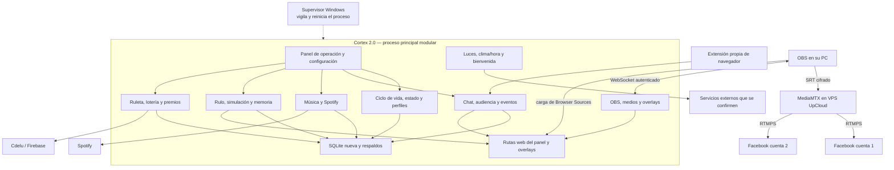
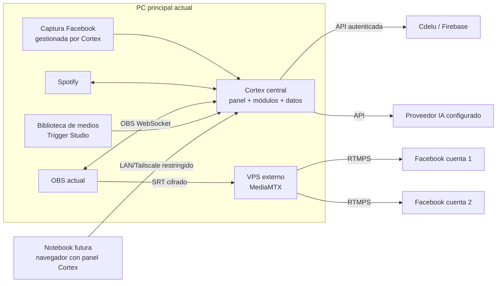
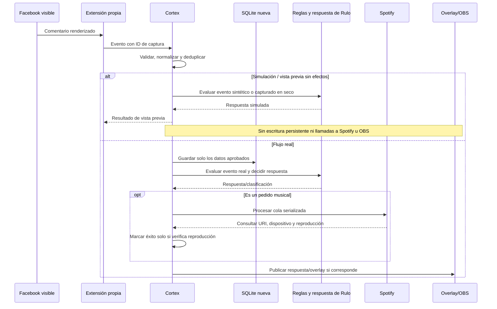
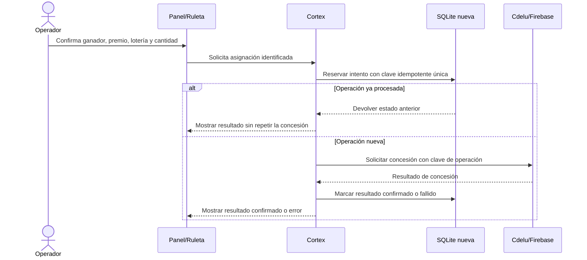

# Organización previa y diagramas para Cortex 2.0

**Fecha:** 12 de noviembre de 2026 (Australia/Brisbane)  
**Estado:** propuesta IA 1 revisada condicionalmente por IA 2; varios detalles operativos aún pendientes.  
**Decisión de alcance vigente:** conservar las funciones de todos los módulos actuales salvo SocialStream Ninja, que el propietario confirma que no usa y pide excluir. La simplificación buscada afecta la organización e implementación; no significa borrar capacidades de los demás módulos.

## Cómo organizarlo antes de crear el proyecto

Primero describir el producto por **capacidades y flujos**, no por las carpetas actuales. Para cada capacidad, completar una fila con:

| Campo | Pregunta |
|---|---|
| ID y nombre | ¿Qué trabajo hace? |
| Responsable | ¿Qué área lógica es dueña de la regla y los datos? |
| Disparador | ¿Quién o qué inicia la acción? |
| Entradas/validación | ¿Qué recibe y qué debe comprobar antes de actuar? |
| Resultado verificable | ¿Qué cambia y cómo se confirma que funcionó? |
| Persistencia | ¿Qué se guarda, durante cuánto tiempo y cómo se borra/restaura? |
| Integraciones | ¿Qué APIs, PC, OBS, navegador o servicios necesita? |
| Fallos | ¿Qué ve el operador si pierde conexión o el proveedor no responde? |
| Contexto de uso | ¿Directo normal, evento ocasional, preparación, recuperación o simulación? |
| Criterio de aceptación | ¿Qué puede probar IA 2 o el propietario para decir “cumple”? |

El propietario ya confirmó que **todos los módulos salvo SocialStream Ninja están en uso y sus funciones deben quedar en el alcance**. Falta describir frecuencia, secuencia y reparto de trabajo entre PCs. Por eso el inventario debe preservar todas esas capacidades hasta que él cambie el alcance; puede marcar qué comportamiento hay que confirmar en vez de eliminarlo.

## Organización objetivo: capacidades internas, menos programas y paneles unificados

La hipótesis de trabajo es un núcleo Go y un **monolito modular**: módulos son límites de responsabilidad dentro del producto, no necesariamente servidores, puertos o aplicaciones separados.

Agruparía las capacidades así, sin perder las funciones existentes:

1. **Operación y configuración:** inicio, perfiles, preflight, estado, diagnósticos, controles y recuperación.
2. **Chat y audiencia:** captura Facebook propia, normalización de eventos, deduplicación, historial, archivos y consultas.
3. **Música:** pedidos, cola Spotify, selección de dispositivo, offsets, respuestas y pruebas aisladas.
4. **Rulo:** overlays, animaciones, biblioteca, conversación, entrenamiento, simulación y Cuaderno Vivo.
5. **Sorteos y premios:** importación de participantes, lotería, premios manuales, correcciones e idempotencia.
6. **OBS y medios:** conexión WebSocket, acciones, catálogo de medios, URLs de overlays, assets y preparación visual.
7. **Herramientas de transmisión:** luces, clima/hora, bienvenida/banner y cualquier otro módulo que el propietario usa.
8. **Adaptadores externos:** proveedores que mantengan su propio ciclo de vida o estén hospedados fuera de la PC Cortex, como servicios de sorteos, Firebase/Cdelu, Spotify y los proveedores de IA. El relay MediaMTX de UpCloud permanece como servicio externo: el nuevo diseño debe reflejar el flujo OBS → SRT → relay → Facebook y los límites para sus claves, sin convertirlo automáticamente en un servidor dentro de Cortex.

Los módulos internos comparten configuración, estado, diagnóstico, logs, rutas web y acceso a la base mediante responsables claros. Las páginas de control y los overlays se pueden servir desde el mismo Cortex; compartir host/puerto reduce procesos, URLs y reglas de firewall. Cada función puede conservar una pantalla propia dentro del panel si eso la hace más clara.

**Conservar separado** solo un proceso que necesite aislamiento, permisos, una instalación independiente, compatibilidad de proveedor o ciclo de vida propio. Eso se justificaría con una razón concreta. “Módulo” no significa “microservicio”.

**SocialStream Ninja queda fuera del diseño objetivo:** no se trasladan su servidor, extensión, relay, overrides ni dependencia heredada. Antes de desarrollo hay que revisar si alguna referencia antigua de otro módulo todavía se necesita; cualquier comportamiento que el propietario sí usa debe tener dueño nuevo documentado, sin traer SSN de vuelta.

## Diagramas que sí conviene tener

No hace falta diagramar cada archivo. Un conjunto pequeño evita que Codex invente conexiones:

1. **Contexto y límites:** propietario, Cortex, OBS, navegador/extensión, Spotify, Cdelu/IAFAS y servicios remotos.
2. **Despliegue de PCs y red:** qué corre en la PC Cortex, qué corre en la PC OBS, qué abre cada equipo y qué conexiones atraviesan LAN/Tailscale.
3. **Mapa de capacidades y datos:** módulos internos, dependencias, dueño de tablas y sistemas externos.
4. **Flujos críticos:** preparación del directo, comentario Facebook → decisión de Rulo/Spotify → overlay, acción OBS y asignación manual de premio.
5. **Estados de seguridad:** modo real frente a prueba aislada; cola y confirmación de Spotify; premio pendiente → confirmado/fallido/idempotente.

Los diagramas de abajo son **propuestas de destino**, no descripción verificada de la instalación actual. Se deben corregir con la respuesta del propietario y las exportaciones de OBS antes de considerarlos requisitos.

Los renders PNG previos se conservaron como históricos en [`diagramas/historicos/`](diagramas/historicos/); la fuente vigente y editable son los bloques Mermaid de este documento.

### 1. Límites funcionales propuestos

### 2. Topología actual y control remoto futuro

El propietario confirma que la PC principal corre Cortex, captura Facebook, Spotify y OBS. La notebook futura solo abre el panel central por una red restringida; no corre OBS, Trigger Studio ni agente local. Si ese rol cambia más adelante, revisar la topología antes de agregar componentes.

El README de UpCloud describe la ruta SRT hacia el VPS y dos destinos RTMPS, pero no se verificó una transmisión. La URL SRT contiene una clave de publicación: nunca mostrarla en registros, capturas ni paneles compartibles. No exponer panel ni WebSocket de OBS a Internet pública. El Trigger Studio actual no autentica sus rutas HTTP/WebSocket, así que su panel remoto antiguo no debe exponerse sin rediseñar esos controles.

### 3. Flujo crítico de comentario y música

La secuencia es una estructura para acordar, no una descripción verificada de cada comentario. El comportamiento actual de Spotify exige comprobar que el tema solicitado se reproduce antes de anunciar éxito; cualquier simplificación debe mantener esa garantía. Antes de implementar hay que definir qué ocurre si Spotify acepta la orden pero se pierde la respuesta: registrar estados de operación y reconciliar antes de reintentar, para evitar mensajes falsos o duplicar efectos. La ruta explícita de prueba contra una cuenta/dispositivo real, si se conserva, debe estar separada de la simulación y requerir una acción deliberada del operador.

### 4. Flujo de asignación manual de premio

### 5. Decisiones de datos antes de codificar

| Decisión | Propuesta inicial |
|---|---|
| Código fuente anterior | No se porta ni traduce; solo sirve como evidencia funcional. |
| SocialStream Ninja | Excluido completamente del diseño nuevo. |
| Base SQLite nueva | Esquema propio desde cero, separado del archivo actual. |
| Datos históricos existentes | No se importan automáticamente ni se eliminan. Preguntar al propietario si quiere archivo histórico accesible o empezar sin él. |
| Integridad de identidad | Identificadores estables; nunca fusionar personas por nombre solamente. |
| Pruebas | Datos sintéticos y almacenamiento temporal/separado; nunca contaminar los datos reales. |
| Copias | Especificar retención, destino, restauración verificada y qué datos sensibles contiene cada copia. |
| Estado de configuración | Una fuente de verdad para configuración compartida; preferencias secretas fuera del panel y del historial de versiones. |

## Estrategias para construirlo sin volver a desordenarlo

- **Una matriz antes del código:** cada módulo viejo se convierte en capacidades y criterios aceptados. El estado “se usa” está confirmado por el propietario; frecuencia y pasos se aclaran en entrevista.
- **Dueño único por regla y por dato:** evitar que Spotify, Rulo, la Ruleta y el panel mantengan copias distintas de la misma decisión.
- **Contratos de integración breves:** definir qué recibe/emite OBS, la extensión, Spotify y cada servicio externo; no añadir bus distribuido.
- **ADRs de una página:** registrar pocas decisiones que cambian estructura: lenguaje, proceso único, base y datos, acceso LAN, OBS, tratamiento de SSN, distribución.
- **Capacidades verticales:** implementar y revisar un flujo de punta a punta antes de abrir el siguiente; cada entrega tiene entrada, salida, estado de error y criterio de aceptación.
- **Cortes por dependencia:** primero configuración/estado; luego conexión OBS y páginas; después datos; después flujos de chat y Spotify; luego Rulo/ruleta y herramientas restantes. Ajustar este orden con el uso real.
- **Definición de “listo”:** comportamiento, errores, prueba aislada, logs sin secretos, backup/restore si hay persistencia y revisión visual en la escena correcta.
- **Revisión de IA 2 por fase:** que cuestione límites y trazabilidad y no solo el código. El propietario decide cuándo pasa la fase y cuándo se reemplaza el sistema.
- **Medir con escenario fijo:** registrar estado inicial de la PC y OBS; repetir el mismo flujo con cada versión. Medición antes de hablar de ahorro.
- **Compatibilidad controlada:** se puede planear una tabla de URLs/rutas nuevas para reconstruir escenas intencionalmente. No copiar la configuración OBS anterior automáticamente.

## Siguiente trabajo documental

1. Completar frecuencia, orden detallado y PC responsable por módulo; el propietario ya describió el flujo general antes/durante/después.
2. Completar contexto/despliegue con ubicación de navegador Facebook, Spotify, OBS, RULO y recursos multimedia.
3. Recibir exportación segura de las escenas que se desean reconstruir o registrar su ausencia como decisión del propietario.
4. Completar una ficha funcional por área y un glosario de nombres.
5. Resolver los hallazgos del [dictamen IA 2](09-DICTAMEN-IA2.md) y validar el requisito de inicio mínimo con captura de dos cuentas.
6. Solo después el propietario decide si autoriza el proyecto nuevo y sus primeros criterios de aceptación.

