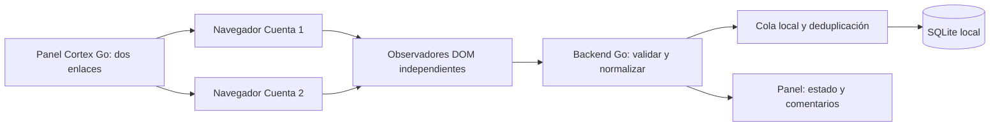

# Guía de captura de dos directos de Facebook desde Cortex Go

**Estado:** prototipo externo Edge/Brave conectado al API local; validación manual pendiente en la PC de escritorio.  \
**Referencia funcional:** el módulo de captura del Cortex anterior.  \
**Alcance:** reconstrucción desde cero; no migrar ni copiar el código anterior. SocialStream Ninja queda excluido.  \
**Retención elegida:** nombres y textos se conservan en la base activa hasta borrado manual. Los respaldos locales se pueden revisar y borrar desde Cortex; las copias exportadas a otro lugar deben borrarse por separado.

## Decisión de método

La API oficial de Meta queda **descartada** para este proyecto. La referencia funcional será el método que ya usa Cortex: Facebook abierto y autenticado en un navegador, captura de los comentarios que la página muestra y envío de esos eventos al núcleo de Cortex.

El navegador tiene que renderizar Facebook para que exista el DOM que se va a observar. Go por sí solo no puede leer ese DOM: Cortex Go coordinará las cuentas, el estado, el guardado y el resto del sistema; una pequeña parte JavaScript dentro de la vista del navegador observará los cambios y entregará los eventos a Go.

## Lo que confirmé en el Cortex anterior

El módulo anterior no dependía de SocialStream Ninja para obtener comentarios. La carpeta `Chat Bot Spotify/extension` incluye una extensión Manifest V3 que:

- Se carga en páginas de Facebook y observa el DOM de los videos y la vista de comentarios de Live Producer.
- Usa `MutationObserver` para detectar cambios relevantes y hace un escaneo de respaldo cada cinco segundos.
- Establece una línea base al comenzar para no volver a procesar todos los comentarios que ya estaban visibles.
- Normaliza nombre, texto, hora, URL/identidad disponible e ID del comentario; también guarda métricas de captura y errores por pestaña.
- Envía eventos normalizados al servicio local con autorización. El servicio informa al panel qué cuenta/pestaña está capturando.
- El botón antiguo acepta un enlace con ID numérico y abre la vista de comentarios de Live Producer. También abre una vista de estadísticas, que es separable de la captura de comentarios.

El README de ese módulo indica que las dos cuentas se usan en **perfiles separados de Brave/Chrome**, con la extensión instalada y una etiqueta diferente para cada perfil. De ese modo, las cookies y la sesión de una cuenta no se mezclan con la otra.

Estas observaciones sirven como requisito y comportamiento conocido. No implican reutilizar la extensión, el servidor Node ni su base de datos en Cortex Go.

## Experiencia buscada en el .exe

En una sección **Facebook en vivo**, mostrar dos tarjetas independientes:

| Cuenta 1 | Cuenta 2 |
|---|---|
| Nombre/etiqueta editable | Nombre/etiqueta editable |
| Campo para pegar el enlace del directo | Campo para pegar el enlace del directo |
| Botón **Abrir y comprobar** | Botón **Abrir y comprobar** |
| Estado de sesión y captura | Estado de sesión y captura |
| Hora del último comentario recibido | Hora del último comentario recibido |
| Reintentar / Cerrar esta cuenta | Reintentar / Cerrar esta cuenta |

La persona pega el enlace que ya usa para el directo. Cortex interpreta el ID cuando el formato es conocido, abre la vista adecuada dentro de la sesión de esa cuenta y verifica que la página esperada haya cargado. Si el enlace no se puede interpretar, muestra qué formato hace falta; no declara la captura activa solo porque abrió una página.

El flujo normal debe ser: abrir Cortex Go, iniciar sesión en cada cuenta solo si venció, pegar los dos enlaces, comprobar que ambas capturas estén vivas y abrir OBS. La notebook solo controla el panel remoto; las sesiones autenticadas y la captura se ejecutan en la PC de escritorio.

## Diseño recomendado para el navegador integrado

Para alcanzar la meta de no abrir Chrome/Brave como programas separados, Cortex necesita **dos vistas de navegador integradas** en su ventana, cada una con un perfil persistente distinto:

1. Cuenta 1 tiene su propio perfil, cookies y sesión de Facebook.
2. Cuenta 2 tiene otro perfil independiente.
3. En cada vista, el script de captura observa únicamente la página asignada a esa cuenta.
4. Los eventos pasan al backend Go por un canal local controlado.
5. Go normaliza, deduplica, guarda en SQLite y publica el estado al panel central.

El motor del navegador todavía no está elegido. WebView2 se había descartado antes por el propietario y no queda aprobado por esta guía. Chromium Embedded Framework es otro candidato, pero requiere más componentes y hace más pesado el paquete. No existe una captura DOM fiable usando solo bibliotecas estándar de Go: si no se integra un navegador, hay que conservar un navegador externo con extensión, como en el sistema anterior.

Una sola ventana visible tampoco garantiza un solo proceso o un único archivo físico: el motor del navegador puede usar procesos auxiliares o requerir componentes instalados. La prueba técnica debe confirmar qué tendrá que instalarse y abrirse en la PC, y si el resultado cumple la preferencia de usar Cortex Go y OBS como las dos aplicaciones visibles.

**Recomendación antes de elegir motor:** hacer una prueba técnica pequeña con dos sesiones aisladas. Confirmar inicio de sesión manual, 2FA, persistencia tras cerrar Cortex, carga de la vista de comentarios, detección de comentarios nuevos, aislamiento de las cuentas y empaquetado. No integrar todavía Spotify, Rulo, sorteos ni acciones de OBS.

## Vistas de Facebook y cantidad de pestañas

En el Cortex anterior, el botón de Live Producer abría una vista de comentarios y otra de estadísticas para cada enlace. Para este primer módulo nuevo, la vista de comentarios es la necesaria. La vista de estadísticas debe ser opcional y agregarse solo si se confirma que sus datos siguen siendo parte del uso habitual.

Las vistas pueden estar en pestañas internas o en dos paneles dentro de Cortex; no hace falta que estén enfocadas para capturar si el motor continúa ejecutando la página. Debe mostrarse cuál cuenta corresponde a cada sesión. No mezclar ambas cuentas en un mismo perfil del navegador ni confiar solo en el nombre escrito: identificar la cuenta iniciada y avisar si no coincide con la etiqueta.

## Flujo de captura y almacenamiento

Campos mínimos por comentario: cuenta/origen, directo, ID de Facebook si está disponible, nombre mostrado, texto, hora original si está disponible, hora de captura y estado de entrega. Un identificador estable evita guardar de nuevo una fila cuando Facebook la vuelve a renderizar. Si Facebook no expone ID, usar una huella compuesta y acotada a cuenta/directo, y documentar que puede haber casos ambiguos.

SQLite debe aceptar el comentario antes de que el panel lo marque como guardado. Si el servicio de almacenamiento falla, Cortex informa el error y conserva el evento pendiente en memoria con límite; no debe mostrar éxito falso. La base y los respaldos contienen datos privados y siguen excluidos del GitHub público.

Las cookies y perfiles del navegador son credenciales. Guardarlos solo en el almacenamiento local privado del equipo donde corra el capturador, fuera de Git y sin sincronizarlos a la otra PC. El host puede cambiar según qué equipo esté disponible; no copies sesiones de Facebook al migrar el proyecto.

## Estado visible y recuperación

Mostrar por separado para cada cuenta:

- Sin enlace configurado.
- Abriendo Facebook o esperando autenticación.
- Requiere iniciar sesión o resolver una verificación de Facebook.
- Página abierta, pero no se encontró la vista de comentarios esperada.
- Captura activa y último comentario recibido.
- Sin comentarios nuevos; la conexión sigue activa.
- Página desconectada, cargando o con error de captura.
- Error al guardar en la base.

El panel debería mostrar también última exploración del DOM, filas visibles, comentarios detectados, enviados y último error resumido. Son métricas inspiradas en el estado por pestaña del Cortex anterior. No guardar el texto completo ni los datos personales en los logs técnicos.

Si Facebook cambia la página, si una cuenta cierra sesión o si se pierde Internet, reintentar solo esa fuente y dejar visible el último evento recibido. Un problema de Cuenta 1 no debe interrumpir Cuenta 2. Acciones manuales: **Reintentar captura**, **Recargar página de Facebook** y, como último recurso, **Reiniciar Cortex**. No ocultar errores tras reconexiones automáticas.

## Límites que hay que aceptar y verificar

La captura DOM solo puede recibir lo que Facebook carga y representa en esa sesión. Puede dejar fuera comentarios filtrados, colapsados, no cargados, eliminados antes de aparecer o inaccesibles por la sesión. Los cambios del diseño o del texto accesible de Facebook pueden exigir ajustar los selectores y volver a validar.

Por eso el panel debe diferenciar entre “navegador abierto”, “página de comentarios encontrada” y “comentarios recientes recibidos”. Ninguna señal aislada garantiza que se estén capturando todos los comentarios.

## Fases de implementación sugeridas

### 1. Prueba de navegador, sin conectar módulos del programa

- Elegir qué motor puede integrarse respetando el rechazo previo de WebView2 o explicar claramente si no se encuentra una opción aceptable.
- Iniciar sesión manualmente en dos perfiles separados y comprobar que sobreviven al cierre normal de Cortex.
- Abrir dos enlaces reales o de prueba y verificar que cada sesión carga la vista de comentarios correcta.
- Confirmar que el observador detecta mensajes nuevos sin reprocesar los que ya estaban visibles.
- Simular que Facebook vuelve a renderizar el chat, cierra sesión o queda sin red; observar estados y recuperación.

### 2. Guardado local y operación

- Enviar comentarios sintéticos al backend Go y verificar que el panel los muestre y SQLite los conserve después de reiniciar.
- Deduplicar eventos repetidos y mantener aislados Cuenta 1 y Cuenta 2.
- Revisar respaldos, cierre ordenado, disco lleno y fallos al escribir.
- Probar ambas cuentas juntas antes de cualquier acción automática.

### 3. Integración gradual

Después de validar captura y guardado, conectar el historial/selección de comentarios que el usuario necesita. Luego integrar Rulo, Spotify y las demás funciones, una por una. Dejar OBS/Trigger Studio para cuando la captura haya demostrado estabilidad; al principio sus acciones siguen siendo manuales.

## Criterios de aceptación

- El operador introduce un enlace por cuenta y ve con claridad cuál sesión lo está atendiendo.
- Las cuentas permanecen separadas y la falta de sesión o fallo de una no tapa el estado de la otra.
- Cortex detecta comentarios nuevos de las dos cuentas, evita duplicados y conserva los datos tras cerrar y abrir la aplicación.
- La pantalla de salud diferencia página lista, espera sin actividad, captura detenida y error de guardado.
- La captura base no requiere SocialStream Ninja, no depende de módulos Node separados y todavía no ejecuta acciones de OBS.
- Los perfiles y cookies no se copian entre equipos. Los comentarios y la base local quedan fuera del repositorio público y no se sincronizan automáticamente a otra PC.

## Referencias del Cortex anterior revisadas

Estas ubicaciones pertenecen al proyecto antiguo y se usan solo para conservar el comportamiento útil durante el rediseño:

- `Chat Bot Spotify/extension/content.js`: observación del DOM, línea base, extracción de comentarios, estado y escaneo de respaldo.
- `Chat Bot Spotify/extension/background.js`: etiqueta de cuenta/pestaña y envío autenticado al servicio local.
- `Chat Bot Spotify/extension/facebook-stats.js`: extracción del ID de transmisión desde enlaces y formatos de Live Producer.
- `Chat Bot Spotify/extension/popup.js`: lectura del enlace, obtención del ID y apertura de vistas de Live Producer.
- `Chat Bot Spotify/extension/manifest.json`: sitios de Facebook donde se inyecta la extensión.
- `Chat Bot Spotify/README.md`: configuración de dos cuentas con perfiles separados, estados y límites de captura.
- `comentarios/server.js`: integración heredada con el resto del Cortex; revisar más adelante para recuperar requisitos funcionales, no para copiarla.

La implementación nueva debe recrear la función con la arquitectura elegida para Cortex Go; no trasladar archivos, datos, sesiones, tokens ni módulos enteros del sistema anterior.

## Estado del prototipo y cierre pendiente

El prototipo de [`experiments/facebook-browser-poc`](../experiments/facebook-browser-poc/README.md) abre dos perfiles Edge o Brave aislados, guarda las sesiones bajo `%LOCALAPPDATA%` y limita DevTools a `127.0.0.1`. La persona inicia sesión y abre manualmente Live Producer > Comentarios en cada ventana. La captura establece una línea base, observa cambios del DOM y vuelve a explorar cada cinco segundos; solo intenta enviar comentarios nuevos al API local de Cortex.

El API guarda origen/cuenta, directo, ID externo cuando está disponible, nombre, texto, hora original y hora de captura. Deduplica por ID externo o huella. El panel presenta métricas por cuenta y permite borrar comentarios de la base activa uno a uno o todo el historial. Los logs del prototipo no imprimen nombres ni textos.

Esto todavía no es la experiencia integrada definida en esta guía: Edge/Brave abre ventanas externas, el prototipo no confirma la identidad de la cuenta y la PC de escritorio aún no se ha validado. No se ha confirmado inicio de sesión/2FA, persistencia tras reiniciar, selectores con comentarios reales, captura simultánea, recuperación de errores ni uso durante un directo. CEF y la integración de los navegadores en Cortex siguen pendientes.

El usuario eligió el escritorio como único host principal. La notebook debe actuar como cliente del panel por Tailscale; no aloja los perfiles de Facebook ni una copia activa de SQLite. El escritorio figura desconectado, así que falta desplegar allí el ejecutable actualizado, configurar Tailscale Serve y validar el enlace remoto.

El borrado de un comentario desde el historial afecta la base activa. Los respaldos anteriores pueden conservar esos nombres y textos y no están cifrados; la lista local de respaldos permite borrarlos uno a uno o todos juntos, tras confirmación. Las copias exportadas a otro lugar requieren borrado separado. No se sincronizan comentarios, respaldos ni perfiles de Facebook a la notebook.
