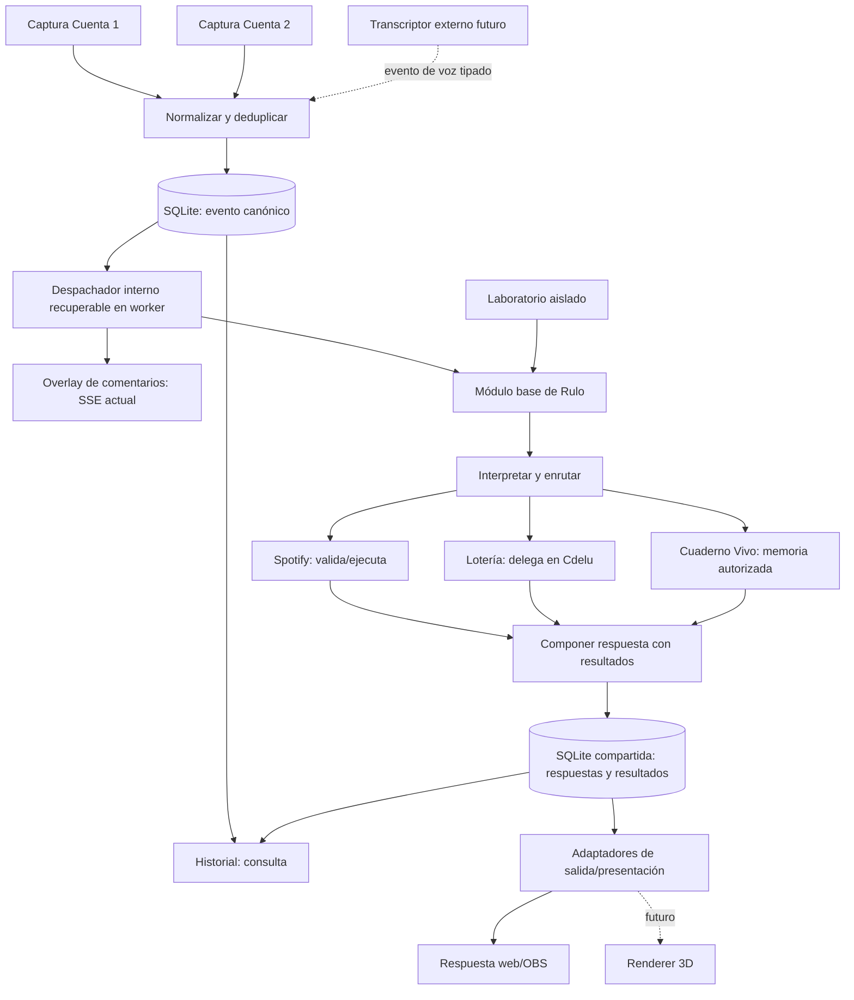

# Guía de análisis y reconstrucción del ecosistema Rulo

**Estado:** guía vigente de arquitectura y alcance. La base local incluye despacho recuperable, sesiones de programa durables, laboratorio privado, perfil de personalidad y reglas generales con ejemplo persistente para simulaciones manuales con DeepSeek, propuestas con casos comparables, respuestas versionadas en historial/overlay, siete casos sintéticos de evaluación local y un consumidor live para Spotify, consultas de reproducción, avisos de lotería y conversación general opt-in. SQLite llega a v18; la conversación general empieza apagada y exige proveedor, aprobación explícita, límites diarios de llamadas y tokens estimados, confirmación del operador del tope monetario externo y activación desde el panel. La confirmación no verifica la cuenta del proveedor. La evaluación live manual usa el mismo adaptador sin publicar ni persistir resultados. No se envía el ID del autor como campo separado, aunque el texto puede incluir datos personales. El presupuesto de tokens limita la ruta live, no es un tope monetario ni cubre todas las llamadas del Laboratorio; antes de activar se requiere un límite de gasto efectivo en la cuenta del proveedor. La cuota de laboratorio manual se mantiene en 30 intentos por ventana móvil de 24 horas. La autorización Spotify estuvo activa antes del redespliegue del 16 de noviembre; el proceso reiniciado devuelve authenticated=false por un error al leer la autorización local, con causa todavía sin confirmar. La cola sigue apagada por defecto y requiere sus otras precondiciones. Cdelu, Cuaderno Vivo, la habilidad pública de estadísticas y las animaciones siguen pendientes; el historial ofrece una vista administrativa agregada. El corte se desplegó en la instancia activa el 14 de noviembre de 2026; no se validó en una emisión real ni en una escena OBS.

**Fecha:** 14 de noviembre de 2026.

**Despliegue — 15 de noviembre de 2026:** el Rulo Unified Overlay quedó integrado en la instancia activa, con lectura del estado Spotify, letras LRCLIB bajo demanda y comentarios nuevos desde el SSE compartido. Sus rutas locales y HTTPS de Tailscale responden; el ajuste se guarda en SQLite y la vista previa no crea eventos. El 16 de noviembre se ocultó visualmente la etiqueta Reproduciendo y el ancho elegido pasó a reflejarse en la vista previa con desplazamiento horizontal. La fuente Navegador de OBS conserva su propio tamaño y aún requiere validación en escena; las animaciones semánticas completas y el adaptador 3D siguen pendientes.

**Revisión incorporada:** el propietario autorizó agregar las recomendaciones de [21 — Revisión previa](21-REVISION-PREIMPLEMENTACION-RULO.md). Esta guía es la fuente vigente de los contratos de diseño; el documento 21 conserva el diagnóstico original. Las tres preferencias consultadas quedaron resueltas: avisos breves de resultados tardíos en overlay, recuperación de pedidos recientes del mismo programa y Cuaderno Vivo más estadísticas del historial incluidos en el primer lanzamiento completo. La implementación local de Rulo fue autorizada después; ninguna decisión de diseño habilita escrituras externas ni generación pública sin sus puertas de aceptación.

**Primer objetivo técnico:** reutilizar el historial/evento como entrada canónica y el despacho recuperable del worker; ambos ya existen en el código local. El capturador ahora envía `participantId` solo cuando la URL del perfil del autor expone un ID numérico explícito; la identidad personalizada sigue vacía, sin sustitución por nombre. Ese dato se conserva privado en el evento y no sale al historial, overlay ni proveedor de IA. Aún falta verificarlo con comentarios reales y enlazarlo con el visitante de Cdelu; por eso no se habilita ninguna reserva. El Laboratorio conserva personalidad y reglas generales para pruebas manuales. La conversación general ya tiene un adaptador live detrás de una preferencia apagada y varias puertas; aún requiere revisión de presupuesto/privacidad, evaluación representativa y aceptación antes de activarla.

## Recomendación de arquitectura

Conviene mostrar **Rulo como una sola sección del panel de Cortex Go**, con una navegación coherente para captura, historial, laboratorio privado, reglas y apariencia. Internamente debe ser un **subsistema modular** de Cortex Go, no un servidor, una base de datos ni un ejecutable separado.

“Módulo” aquí significa un límite lógico de responsabilidad, no una aplicación separada ni un componente para cada botón. Cortex mantiene un núcleo común; cada dominio cohesivo tiene su servicio, rutas, ajustes y recursos cuando corresponda. Rulo coordina conversación y habilidades. Spotify conserva su propia cola/conexión; Lotería, su acceso a Cdelu y las reglas de ese dominio. El parser, las plantillas y el botón **Guardar regla** son partes de Rulo, no módulos nuevos.

### Qué pertenece al módulo base de Rulo

El **módulo base de Rulo** debe contener la personalidad general, la política de participación espontánea, el enrutador de intenciones y habilidades, y el Laboratorio de Rulo como punto único para conversar, revisar una interacción, proponer una mejora, simularla y guardar reglas o casos de evaluación. Estos elementos son compartidos por todas las habilidades, así que no conviene convertir el laboratorio o la personalidad en módulos independientes.

El límite de propiedad sigue siendo claro: el módulo base guarda y aplica las reglas generales de conversación y coordinación; cada módulo dueño conserva su vocabulario especializado, validación, configuración y ejecución. Por ejemplo, el laboratorio puede ser una sola interfaz, pero la interpretación de artistas y canciones pertenece a Spotify y las reglas de lotería siguen en Cdelu. Al guardar una corrección, Rulo la clasifica y la envía al dueño correspondiente; no mantiene una copia paralela de esas reglas. Los casos de evaluación compartidos pueden comprobar que el enrutamiento y la respuesta de extremo a extremo sigan funcionando.

Las referencias heredadas de Cuaderno Vivo atribuyen a ese módulo el perfil de personalidad. Para la arquitectura nueva, el propietario ya decidió que la **personalidad general y su entrenamiento pertenecen al módulo base de Rulo**. Cuaderno Vivo queda como dueño de memoria/contexto asociado a personas y datos con procedencia; puede aportar contexto permitido, pero no sobreescribe la voz global. La migración futura debe clasificar cada instrucción antigua antes de asignarle dueño.

Así se puede simplificar la operación sin mezclar responsabilidades:

| Parte | Responsabilidad única |
|---|---|
| Captura | Recibir comentarios visibles, identificar cuenta/directo y publicar un evento normalizado. |
| Historial de audiencia | Conservar y buscar comentarios públicos y sus copias por programa. |
| Módulo base de Rulo | Mantener personalidad general, procesar eventos elegibles, elegir una o varias habilidades, coordinar resultados y ofrecer el laboratorio unificado. |
| Spotify | Recibir pedidos claros, mantener la cola y confirmar qué se reprodujo. |
| Lotería | Consultar en Cdelu reglas, participación y cupo de números extra; asignar automáticamente el número elegido si cumple los requisitos y está libre. |
| Cuaderno Vivo | Usar recuerdos y reglas aprobados, vinculados a identidades estables. |
| Presentación | Mostrar respuestas y estados de Rulo en web/OBS; un renderer 3D futuro consume el mismo contrato. No decide acciones ni inventa resultados de otros módulos. |

### Inventario de capacidades y límites

Esta matriz aclara qué comportamiento se conserva del sistema anterior, quién manda sobre cada dato/acción y qué queda confirmado para la versión nueva. “Confirmado” identifica el alcance acordado por el propietario; “planificado” y “candidato” requieren resolver los puntos pendientes de esa fila antes de implementarse.

| Capacidad | Evento o entrada | Módulo dueño y papel de IA | Efecto permitido | Estado de alcance |
|---|---|---|---|---|
| Conversación y participación espontánea | Comentario live de una sesión activa seleccionado por la política de muestreo | Rulo decide si responde, pregunta, bromea o guarda silencio; la IA ayuda con comprensión y redacción, sin validar hechos. | Respuesta en overlay e historial; sin publicar en Facebook. | Integrada localmente detrás de un opt-in apagado por defecto; faltan aceptación de privacidad/gasto, ajuste de frecuencia y validación de vivo. |
| Preguntas de espectadores | Comentario con pregunta | Rulo enruta; el módulo que posee el dato (por ejemplo Spotify o Cdelu) aporta evidencia. La IA redacta a partir de ese resultado. | Contestar con hechos disponibles; pedir aclaración o reconocer el límite cuando falte evidencia. | Confirmada para la versión pública completa. |
| Pedido musical | Comentario con canción, artista o género | Spotify conserva vocabulario, parser, cola, permisos y conexión. La IA puede ayudar a interpretar lenguaje flexible; Spotify valida y confirma. | Agregar/reproducir según las reglas vigentes, con deduplicación y estado confirmado. | Confirmada para la versión pública completa. |
| Elección de número de lotería | El participante pide su número elegido desde una identidad enlazada | Lotería delega identidad, reglas, números extra, elegibilidad y disponibilidad a Cdelu. La IA extrae intención/número, no concede permisos. | Asignar automáticamente el número solicitado solo si Cdelu confirma requisitos y disponibilidad. | Confirmada; requiere identidad estable y contrato Cdelu. |
| Laboratorio, simulación y entrenamiento | Entrada escrita por el administrador, caso seleccionado o evento archivado/sintético | Rulo comparte el motor de decisión; la IA propone diagnósticos y reglas que deben quedar clasificadas para su módulo dueño. | Efectos simulados por defecto; guardar reglas de forma explícita. Una integración real requiere un destino de pruebas efectivamente separado y visible; si no existe, solo se simula. | Confirmada como herramienta privada de administración. |
| Memoria y contexto por persona | Consulta que necesita un recuerdo autorizado | Cuaderno Vivo es dueño de memoria/procedencia; Rulo conserva la personalidad global. | Aportar solo el contexto pertinente con identidad estable y reglas de retención definidas. | Confirmada para el primer lanzamiento completo; concretar acceso, retención y alcance de datos antes de activarla. |
| Consulta analítica del archivo | Pregunta sobre participación o programas archivados | La capa de audiencia/historial ejecuta consultas permitidas y entrega agregados; la IA solo los explica. | Lectura agregada, acotada por período y evidencia; sin SQL libre ni comentarios completos en el prompt. | La vista administrativa inicial ya entrega conteos por día/cuenta y totales separados de chats guardados; falta decidir qué consultas puede contestar Rulo públicamente y en qué programas/períodos. |
| Transcripción de voz del streaming | Segmento completo de voz recibido de un productor externo | El adaptador de voz tipa y consolida segmentos; Rulo decide si se lo llama y si hay una solicitud clara. | Reutilizar las habilidades existentes después de reconocer una frase completa; no fingir un comentario de Facebook. | Futura; definir productor, hablantes, retención y prioridad. |
| Presentación visual | Respuesta/estado semántico ligado al evento y a su resultado | Rulo publica el estado; el overlay y los renderers solo lo muestran. | Overlay e historial son los destinos acordados; Web/OBS primero y 3D como adaptador posterior. | Overlay e historial confirmados; 3D futuro. |

La matriz no crea servicios paralelos: cada fila usa el evento compartido y el módulo dueño indicado. Un módulo nuevo debe declarar su entrada, su fuente de verdad, su posible efecto y el estado de alcance antes de conectarse a Rulo.

**Política inicial recomendada para estadísticas públicas (pendiente de aceptación del propietario y desactivada hasta entonces):** responder solo totales agregados del programa actual o de un programa archivado identificado expresamente, con un período máximo de 30 días. Mantener los conteos de chats archivados separados de los eventos capturados para no sumar copias potenciales. No revelar desgloses por cuenta/feed, nombres, IDs, mensajes, rankings de participantes ni fragmentos del chat. La API debe resolver una consulta tipada y acotada; el modelo puede resumir el resultado agregado, pero nunca recibe filas del historial ni genera SQL. Si el período/programa no está claro o el dato no está disponible, Rulo pide precisión o explica el límite. La autorización general de incluir estadísticas en el primer lanzamiento no activa esta política por sí sola: el dueño debe aceptarla antes de habilitar respuestas live.

**Lista de cierre del primer lanzamiento completo, confirmada por el propietario:** conversación espontánea y preguntas, laboratorio y reglas, pedidos Spotify, elección de números Cdelu, Cuaderno Vivo, consultas de estadísticas del historial y presentación web/OBS con historial. Cuaderno Vivo y estadísticas se integran en la etapa 5 y son requisitos de cierre del lanzamiento, no capacidades opcionales para después. Sus políticas de acceso, retención y datos permitidos se concretan antes de activarlas. Voz externa y 3D siguen siendo futuros. Las otras áreas de Cortex no se transforman automáticamente en habilidades públicas: asignar un número no autoriza conceder premios, girar bolilleros ni cambiar escenas.

Estas partes deberían compartir el worker, SQLite, el plano de control, SSE y los mecanismos de respaldo ya existentes. Un navegador auxiliar para leer Facebook puede seguir siendo necesario por el DOM; sería un adaptador administrado por Cortex, no otro producto con su propia historia y panel paralelo.

### Presentación y animaciones de Rulo

Las animaciones son parte de la **capa de presentación**, no una habilidad conversacional ni otro motor de Rulo. El módulo base decide qué estado o reacción corresponde y publica una señal semántica; un adaptador de presentación decide cómo dibujarla. Así, “Rulo está hablando”, “está dormido” o “reacciona a un pedido musical” no queda atado a un video, una página web o un modelo 3D concretos.

Conviene considerar desde el diseño un contrato de salida compartido que relacione cada respuesta o reacción con el `eventId`, indique el tipo de estado y su comienzo/fin o cancelación, y transporte el texto que corresponda mostrar. El contrato expresa intención y sincronización, no nombres de archivos ni instrucciones de una animación particular. Debe tolerar reconexiones, conservar el orden, resolver eventos repetidos y tener un estado neutral de respaldo si el renderer no reconoce una señal. El renderer solo presenta el estado: nunca ejecuta Spotify, lotería ni otras acciones. Una animación de éxito se emite únicamente después de que la habilidad confirme su resultado.

El contrato que existe ahora en Go persiste `responseId`, `eventId`, versión, señal textual y marcas de tiempo; sus señales son `speaking`, `success`, `warning` y `error`. Eso sincroniza la respuesta con el comentario, pero aún no describe inicio/fin/cancelación de una animación, estado visual neutral, prioridad de controles manuales ni señales no ligadas a una respuesta. Antes de conectar un renderer, completar un sobre semántico con esas transiciones y mantener la versión de respuesta correlacionada. No guardar nombres/rutas de clips dentro de decisiones o resultados de habilidades.

La salida web/OBS es el primer adaptador del diseño nuevo. Hay además un prototipo independiente de **Rulo Studio 3D para Godot Web**: sus controles manuales seleccionan, reproducen, pausan y recorren animaciones, permiten repetirlas y ajustar sombras, luz, encuadre y fondo. Su documentación registra transparencia alfa y cambios de animación probados en navegador; la integración de la escena final y una prueba prolongada en OBS siguen pendientes. Es referencia funcional, no un módulo integrado ni evidencia de que OBS ya esté validado. No incorporar su servidor Node, puerto, ejecutable ni configuración como paralelo a Cortex Go. Según el alcance vigente, el renderer 3D queda para una etapa futura y consume el mismo contrato.

Las dos guías técnicas locales de animación difieren en el empaquetado. La versión más reciente, v2, sustituye la propuesta anterior de un WebM largo por familia: propone un archivo independiente por clip, organizado en carpetas de comportamiento, sin rangos `start/end`. Conserva el MP4 original y usa FFmpeg durante importación/preparación, no durante el directo. Sugiere normalizar canvas y proporción sin deformar al personaje, FPS/resolución, audio desactivado por defecto y transparencia opcional solo cuando el fondo es conocido; el chroma key no se debe adivinar. Los metadatos por clip contemplan familia, pose inicial/final, loop, peso, interrupción, prioridad y cooldown. La capa de presentación sería dueña de la cola y transiciones entre poses, precarga/caché y doble buffer para evitar microcortes; OBS solo presenta la Browser Source. Estas decisiones quedan como requisitos de la integración futura, no autorizan importar o reprocesar medios en este corte.

Un modelo 3D futuro es otro adaptador del mismo contrato; no requiere duplicar personalidad, IA, historial ni habilidades. La conexión a voz o sincronización labial puede agregarse si se decide usar audio, sin hacer que el núcleo de Rulo dependa de ella.

La base debe reservar este límite y el formato semántico durante su diseño; la construcción y el ajuste de animaciones se dejan para el cierre, una vez estables las respuestas, las habilidades y sus señales. El adaptador 3D queda para una etapa futura y puede consumir el mismo contrato.

### Entrada futura: transcripción de voz del streaming

El propietario anticipa una capacidad futura en la que un programa externo convierte en texto, en tiempo real, lo que se dice durante el streaming. Rulo podría responder cuando escuche que lo llaman por su nombre —por ejemplo, “Rulo” seguido de una pregunta— y entender que la intervención está dirigida a él. Esta idea queda registrada para el diseño futuro; **no forma parte de la implementación inmediata ni bloquea la base inicial de Rulo**. El proveedor de voz a texto y el programa que entregará las transcripciones todavía están por definir.

La transcripción debe entrar por un adaptador/productor conectado al flujo compartido de Cortex, como un tipo de evento distinto de los comentarios escritos del chat. No se debe fingir que la voz es un comentario de Facebook ni crear otra historia de chat. Cuando estén disponibles, conviene conservar origen, ID de segmento/frase, tiempos, indicador de frase completa y, si el proveedor los entrega, hablante y confianza. Las revisiones parciales de una misma frase se consolidan para que Rulo no responda varias veces antes de oír la pregunta completa.

El enrutador base puede aplicar una política configurable de activación: responder cuando la transcripción completa incluya la palabra de llamada “Rulo” y una pregunta o petición clara dirigida a él. El nombre aislado, una frase incompleta o un reconocimiento dudoso no deben disparar una acción; el umbral y las variantes de reconocimiento se afinan en el laboratorio con ejemplos. Si no se puede determinar quién habla, Rulo no debe inventar una identidad. La transcripción puede transportar información personal: se define su retención y acceso antes de persistirla, y el audio no se guarda por defecto.

Esta entrada reutiliza el mismo motor de Rulo, personalidad, habilidades, evento de salida y renderers web/OBS o 3D. La captura/transcripción pertenece a su adaptador de entrada; Rulo se ocupa de decidir si la frase se dirige a él y qué hacer. La integración se agrega cuando el propietario la priorice y defina proveedor, hablantes, latencia, permisos y retención.

## Estado actual que condiciona el plan

- Cortex Go ya tiene historial, archivos por programa, búsqueda, borrado, destacados y overlays de comentarios sobre la SQLite compartida.
- La captura de Facebook alimenta el historial unificado y el worker persiste sobres recuperables. El consumidor en vivo limita el manejo a eventos nuevos de la sesión activa y Rulo reanudado: pedidos explícitos Spotify con coincidencia exacta, preguntas claras sobre reproducción y, solo con opt-in/configuración, conversación general acotada. Un pedido de lotería solo recibe un aviso de que no se ejecutó; no consulta ni modifica Cdelu. Sin la preferencia IA, el resto de los comentarios no recibe conversación general.
- El historial ya unifica los eventos recibidos de las cuentas en el registro de Cortex. Si ambas cuentas aparecen correctamente allí, ese resultado es la entrada común que Rulo necesita; no hay que validar la captura otra vez para Rulo.
- La conversación general live ya existe detrás de un opt-in apagado inicialmente; solo responde de forma conversacional y no sustituye a las habilidades dueñas. El comportamiento completo de Rulo, Rulator, Spotify y Cuaderno Vivo sigue en el sistema anterior. Se revisaron sus guías y pantallas de referencia, pero no se importaron sus conversaciones, configuraciones privadas, sesiones ni bases.
- El proyecto anterior documenta varias superficies y responsabilidades: historial de comentarios/respuestas, simulación Rulator, conversación privada de prueba, Spotify, Cuaderno Vivo y controles visuales. La inspección de datos personales, bases y secretos queda fuera de esta guía.

Por eso, **no conviene empezar escribiendo el bot**. Primero se revisa qué ya está demostrado por el historial. Si allí aparecen comentarios nuevos de ambas cuentas, sin duplicados y conservados en SQLite, esa etapa se marca como aceptada y se sigue adelante. La validación de captura es una condición compartida del sistema, no una prueba adicional para Rulo.

Rulo recibe el mismo evento ya normalizado y guardado que ve el historial; no necesita leer la interfaz ni consultar Facebook. El worker crea el sobre compartido en la misma transacción que inserta el evento y conserva cursores de consumo recuperables en SQLite. `GET /api/events` sigue siendo una API de historial, no un bus interno; el SSE del overlay solo presenta comentarios y respuestas. Para Spotify, el cursor avanza después de guardar una respuesta o de dejar una operación durable de la sesión activa. El `eventId` de Cortex sigue siendo la correlación canónica. Tras restaurar una copia, la conversación IA live se apaga y requiere activación explícita otra vez; así una preferencia antigua no vuelve a enviar mensajes por sorpresa.

## Auditoría integral y recomendaciones para una base sólida

La revisión cruzó esta guía, el estándar de módulos, el contrato Go actual y las guías funcionales legibles del sistema anterior. El Cortex anterior se deja intacto; no se importan sus bases, sesiones, secretos, cuentas ni datos personales.

### Hallazgos y prioridad

| Prioridad | Hallazgo | Recomendación |
|---|---|---|
| Antes del Rulo en vivo | El evento Go actual representa comentarios y separa `sourceId` (capturador), `feedId` (cuenta), `externalId` (comentario) y `author` (nombre visible), pero no incluye `eventType` ni ID estable del participante. El handler persiste y llama al broadcaster específico del overlay; aún no hay despacho interno general para módulos. | Diseñar un sobre de evento común con origen, tipo, ID único en el ámbito de su origen, hora del hecho y hora de recepción, y datos tipados; añadir ID estable del autor por separado cuando la fuente lo entregue. Agregar despacho recuperable dentro del worker y consumir solo eventos ya confirmados en SQLite. El sobre puede inspirarse en CloudEvents sin adoptar su SDK ni montar otra infraestructura. |
| Decisión cerrada: destino de respuestas | El propietario confirma que Rulo debe aparecer solo en el overlay y el historial. | No crear ni habilitar un emisor de comentarios para Facebook. Las respuestas de Rulo se muestran en su overlay y se relacionan con el historial; OBS debe consumir la salida de presentación autorizada. |
| Antes de migrar instrucciones | Cuaderno Vivo antiguo se describe como dueño del perfil de estilo, mientras la arquitectura nueva asigna personalidad general y su entrenamiento al módulo base de Rulo. | Adoptar el límite nuevo: Rulo posee voz global y política conversacional; Cuaderno Vivo posee recuerdos/contexto por persona. Clasificar cada instrucción heredada antes de migrarla; no importar el snapshot entero como una sola personalidad. |
| Antes de Spotify/Cdelu | Un comentario puede pedir conversación y más de una acción; una respuesta generada no demuestra que una acción haya ocurrido. | El enrutador crea intenciones; cada módulo valida y ejecuta lo suyo y devuelve resultado estructurado. La IA no llama directamente a Spotify/Cdelu ni decide si sus validaciones se cumplen. Cada operación usa `eventId` y una clave idempotente propia; reintentar un resultado incierto primero consulta el dueño del dato. |
| Antes del primer lanzamiento | El laboratorio ya tiene el principio de guardar explícitamente, pero faltan criterios de salida comparables para personalidad, detección, silencio y efectos. | Mantener ejemplos activos separados de casos de evaluación; guardar respuesta esperada, habilidad, acción simulada y criterio de éxito. Comparar la regla propuesta con los casos aprobados y conservar la intervención espontánea acotada por frecuencia y cooldown. |
| Antes de usar memoria/transcripción | Historial, archivos de programa, memoria personal, pruebas y telemetría son conjuntos distintos; los respaldos pueden retener datos después de borrar el original. | Relacionar por ID, evitar copias de comentarios y prompts crudos, decidir borrado/retención también para archivos y respaldos. No enviar identidad estable a la IA. La transcripción de voz sigue siendo futura y tipada aparte. |

**Prioridad de implementación:** el contrato y el despachador compartido son la fundación técnica; el módulo base/laboratorio puede comenzar con eventos sintéticos y la salida heredada del overlay. La identidad estable es necesaria antes de acciones Cdelu, no para la conversación. La transcripción externa y el renderer 3D son adaptadores futuros; publicar respuestas en Facebook queda fuera de lo autorizado.

### Lecciones concretas del sistema anterior

La auditoría funcional revisó las guías de Rulo, Rulator, Spotify, Cuaderno Vivo y animaciones, además de las pantallas de entrenamiento y los puntos de integración de servidor necesarios para confirmar esos flujos. El proyecto antiguo permanece intacto. No se leyeron bases, claves, sesiones ni datos personales.

| Área observada | Patrón útil del legado | Decisión para Cortex Go |
|---|---|---|
| Rulator y conversación de prueba | Una misma sala permitía reproducir comentarios archivados, agregar participantes sintéticos, conversar y guardar casos. Separaba esas pruebas del historial real; el contenido archivado se trataba como dato no confiable. | Conservar un único Laboratorio de Rulo con escenarios etiquetados como sintéticos, archivados o escritos por el administrador. Las pruebas ordinarias usan adaptadores de efectos simulados; una prueba con un efecto real, como Spotify, exige habilitar explícitamente el modo aislado y mostrar qué cambiará. Ningún escenario se reinyecta como evento vivo ni se entrena solo por reproducirse. |
| Detección de música | El vocabulario, sinónimos, verbos, géneros, correcciones de escritura y parser determinista eran editables. La IA se consultaba como apoyo cuando la detección local no alcanzaba; después se comprobaban sus campos y se podía volver al parser. | Spotify conserva su vocabulario y parser en su módulo. Resolver primero los pedidos claros localmente; reservar IA para lenguaje flexible o errores no cubiertos. Validar artista, título, género, confianza y campos obligatorios contra el texto y el catálogo local antes de crear una solicitud para Spotify. Una interpretación de IA nunca equivale a una reproducción confirmada. |
| Respuestas y análisis con IA | La conversación, la interpretación musical, la generación de frases y el análisis de mejoras eran tareas diferentes aunque compartieran configuración del proveedor. El analizador revisaba una interacción y proponía un destino: regla general, entrenamiento musical, revisión de lotería o dato que debía verificarse. | Mantener un adaptador común de proveedor, pero contratos, límites y fallbacks separados por tarea: interpretar una intención, redactar una respuesta o proponer una mejora. El analizador entrega un borrador clasificado; no activa reglas, no inventa hechos y no reemplaza la validación de la habilidad dueña. Las reglas de lotería y hechos requieren su fuente; las correcciones musicales se guardan en Spotify. |
| Entrenamiento | Las reglas de comportamiento se activaban mediante una acción explícita; las respuestas de prueba y la biblioteca de evaluación no entrenaban automáticamente. Los datos factuales requerían fuente. | Conservar **Guardar regla** como único paso que activa una instrucción. Separar perfil, reglas activas y casos de evaluación. Ofrecer la prueba opcional de la regla con el caso original, una paráfrasis, una ambigüedad y un caso negativo; permitir editarla o quitarla y volver a ejecutar los casos afectados. |
| Memoria y estilo | Cuaderno Vivo tenía memoria revisable por participante y la guía proponía centralizar allí personalidad, recuerdos y contexto reciente; también proponía cuatro tonos con ajuste manual/automático. | Aplicar la decisión nueva: personalidad y entrenamiento general pertenecen a Rulo base. Cuaderno Vivo aporta solo recuerdos/contexto por persona, con procedencia y relevancia. No mezclar recuerdos persistentes con el contexto corto del chat ni trasladar todo el archivo al prompt. Si se conserva un selector de tono, debe cambiar la redacción solamente; no permisos, hechos ni acciones. |
| Archivo y analítica | Rulo podía contestar preguntas administrativas usando agregados de participación y resúmenes del archivo; la IA recibía los agregados necesarios, no la colección completa de comentarios. | Incluida por el propietario en el primer lanzamiento completo: consulta de archivo de solo lectura mediante consultas permitidas del dueño de audiencia, con agregados, período y evidencia. No habilitar SQL libre ni enviar transcripciones completas al modelo; definir qué agregados son publicables y cuáles quedan restringidos al operador. |
| Overlay y animación | Web/OBS y el ejecutable 3D eran métodos de presentación distintos; los estados `idle`, `thinking`, `success`, `warning`, `error` y `speaking` comunicaban el resultado del flujo. | Mantener la salida autorizada de Rulo en overlay e historial. Diseñar señales semánticas vinculadas al evento y al resultado confirmado; la web/OBS es la primera vista y el renderer 3D futuro consume el mismo contrato. La señal visual no ejecuta acciones ni puede mostrar éxito antes de la confirmación del módulo. |

No convertir cada valor antiguo en un requisito. La probabilidad de respuesta casual, cooldowns, cantidad/antigüedad del contexto reciente, escalas de tono y umbrales de carga descritos en las guías son parámetros de una implementación o propuestas de calibración; deben probarse con casos actuales antes de elegir valores. En particular, una métrica de actividad o pedidos no debe hacer que Rulo descargue enojo sobre una persona ni modificar cómo una habilidad valida una acción.

#### DeepSeek y la capa de IA

El sistema anterior configuraba un endpoint y un modelo compatibles con los formatos de chat/responses; el backend conserva un valor predeterminado de DeepSeek, pero la configuración permitía otros endpoints. La clave se resolvía del lado servidor. Esto demuestra que el proveedor era una pieza reemplazable, no una regla de Rulo que haya que copiar como dependencia permanente.

Para Cortex Go recomiendo una interfaz de proveedor central y tareas delimitadas:

1. **Interpretar intención:** recibir solo el comentario y el vocabulario/contexto imprescindible; devolver JSON acotado con intención, campos extraídos, campos faltantes y confianza. Las reglas deterministas siguen resolviendo casos claros.
2. **Redactar respuesta:** recibir la pregunta y resultados ya verificados por las habilidades. Puede elegir las palabras, pero no declarar una acción como exitosa ni completar datos ausentes.
3. **Sugerir mejora:** analizar una interacción seleccionada y devolver categoría, destino, borrador y si necesita una fuente. La respuesta queda en el Laboratorio hasta que el administrador la edite y guarde.

Cada tarea tendrá su propio límite de tiempo, tamaño de salida y fallback aunque use la misma credencial/proveedor. Si la API falla, la interpretación vuelve al parser o pregunta/no actúa; una respuesta puede usar una frase local breve o guardar silencio; el analizador informa que no pudo sugerir. Ningún error de IA debe detener el capturador, repetir una acción ni bloquear el overlay.

Usar JSON estructurado ayuda a validar salidas, pero el modo JSON por sí solo no garantiza que el resultado esté completo ni que sus valores sean correctos. La aplicación debe comprobar parseo, esquema, enumeraciones, longitudes y coherencia con el comentario antes de aceptar cualquier resultado. DeepSeek documenta tanto el modo JSON como los casos de contenido vacío o truncado, así que esas respuestas deben tratarse como fallidas y pasar por el fallback local ([guía oficial de JSON Output](https://api-docs.deepseek.com/guides/json_mode/), [referencia oficial de Chat Completions](https://api-docs.deepseek.com/api/create-chat-completion/)). La integración de Go solo está disponible en el laboratorio privado; una simulación manual envía el ejemplo elegido y, si existen, el perfil y las reglas activas de Rulo limitadas por el servidor. El consumidor no transmite comentarios reales al proveedor. La clave se configura fuera de la base y nunca se refleja en estado o UI.

No exponer llamadas de herramientas que escriban en Spotify o Cdelu directamente al modelo. Si más adelante se usa function calling, la salida se interpreta como una propuesta de intención y vuelve a pasar por la validación, autorización, idempotencia y ejecución del módulo dueño. El proveedor/modelo final, sus costos y el umbral por tarea quedan abiertos hasta comparar casos del Laboratorio; el nombre de modelo del sistema anterior no se fija como requisito.

### Contratos de ejecución incorporados

Estos contratos desarrollan las recomendaciones aceptadas. Su implementación usa el worker y la SQLite existentes; no añade otro bus, servidor ni base. El resumen por frente de abajo debe interpretarse con estas reglas.

#### Entrada, sesión y recuperación

El sobre compartido identifica versión de esquema, `eventId`, tipo, productor/origen, ID externo con su ámbito de unicidad, hora ocurrida/recibida, sesión de vivo, ámbito vivo/laboratorio y datos tipados. La identidad estable del participante es opcional en el evento y obligatoria para acciones que la requieran; no se deduce del nombre, cuenta de captura o comentario. El servidor asigna y valida los metadatos de ámbito y origen: el texto o una salida de IA no pueden conferir permisos.

El consumidor acepta solo tipos y productores habilitados. Los eventos sintéticos actuales con origen `test:`, las reproducciones de archivo y las sesiones de laboratorio nunca habilitan efectos del vivo. Respuestas propias y resultados de habilidades actualizan su interacción; no vuelven al enrutador como comentarios nuevos.

Al habilitar un consumidor por primera vez se registra un punto inicial, sin ejecutar el archivo anterior. Una sesión agrupa las transmisiones habilitadas de ambas cuentas; no usa `feedId` como identidad de participante. Su identificación y cierre deben quedar definidos antes del vivo. Cada clase de acción tiene vigencia y plazo: un evento vencido se conserva como historial, pero no inicia efectos. Una reserva mantiene la lotería objetivo original; no se cambia a otra lotería durante un reintento.

El cursor sigue el orden persistido, no las horas que puedan llegar desordenadas desde las fuentes. Avanza cuando la entrada queda registrada como trabajo recuperable o descarte con motivo; no basta con entregarla a una goroutine. Un consumidor lento no bloquea la captura ni a los otros consumidores. Al reiniciar, se recuperan estados y operaciones vigentes; no se interpreta todo el atraso como solicitudes actuales. Decisión del propietario: al reanudar se recuperan solo los pedidos recientes del mismo programa que aún no se hayan enviado. Se conserva su orden y se revalidan vigencia, identidad, destino y reglas actuales antes de ejecutar. Los pedidos vencidos o de otro programa no se ejecutan; tampoco se recupera la charla espontánea atrasada. La ventana que define «reciente» será configurable por habilidad, con un valor inicial y un máximo fijados antes del vivo. Reconciliar acciones ya enviadas siempre sigue permitido, sin confundirlo con enviar pedidos nuevos.

Cortex ya dispone de una sesión de programa compartida que el operador inicia y cierra en el panel central. El servidor vincula cada comentario entrante a la sesión activa dentro de la persistencia; comentarios sintéticos y eventos previos quedan sin sesión. La sesión activa sobrevive a reinicios. Cerrar una sesión detiene nuevas acciones asociadas, pero no se interpreta como cancelación de efectos externos enviados. Spotify ya aplica vigencia, operación durable, orden FIFO y reconciliación limitada; las demás habilidades deben implementar esos contratos antes de recuperar pedidos.

#### Operaciones, resultados y varias habilidades

Antes de una llamada con efecto, persistir operación, intención validada, habilidad, destino, sesión, correlación y clave idempotente. La intención y su clave quedan fijadas: no se regeneran al reintentar, volver a ejecutar el modelo o cambiar el orden de sus propuestas. La clave debe contemplar el origen estable de la solicitud y el destino; el entero local `eventId` por sí solo no garantiza unicidad frente a recapturas o restauraciones.

El despachador puede entregar de nuevo el evento. El módulo dueño consulta la operación y evita repetir efectos mediante idempotencia y reconciliación. No prometer ejecución exactamente una vez cuando el servicio externo no la puede garantizar. Ante resultado desconocido, consultar al dueño antes de reintentar; si no existe una consulta fiable, mantener `incierto` y explicar la recuperación necesaria. Antes de habilitar Cdelu hay que comprobar asignación atómica, claves idempotentes, consulta de resultado y su vigencia real.

| Estado de operación | Significado y transición permitida |
|---|---|
| `pendiente` | Operación durable aún sin aceptación confirmada del ejecutor; puede esperar una dependencia o un reintento que se sabe seguro. |
| `aceptado` | El ejecutor confirmó recepción o cola; todavía no acredita el efecto final. Puede pasar a completado, fallido o incierto. |
| `completado` | El módulo dueño confirmó el efecto solicitado. No se vuelve a ejecutar por repetir la entrada. |
| `rechazado` | La validación impidió ejecutar la solicitud. Incluye el motivo público permitido. |
| `fallido` | Fallo confirmado sin efecto realizado. Reintentar solo si la clasificación del dueño lo permite, con la misma operación y clave. |
| `incierto` | Se pudo haber producido el efecto, pero no se conoce el resultado. Solo consulta/reconciliación; no reenvío ciego. |
| `vencido` | Se agotó la vigencia antes de enviar la operación. No se aplica a una llamada que pudo haber producido efectos. |
| `cancelado` | Se detuvo antes de enviarla, o el dueño confirmó cancelación sin efecto. Una cancelación local no demuestra cancelación externa. |

Registrar además si hubo envío y el identificador externo disponible. El timeout de una llamada con posible efecto produce incertidumbre, no un rechazo ficticio. Las transiciones dependen de evidencia del módulo, no de la redacción del modelo. Esperar una aclaración es estado de interacción, anterior a una operación ejecutable.

Spotify materializa este contrato en `spotify_operations`: persiste la clave idempotente y la sesión antes del POST, consulta reproducción/cola/dispositivo, serializa el pedido más antiguo y distingue `aceptado` de `completado`. La confirmación 204 de Spotify no se presenta como reproducción. Ante timeout o error después del envío no hay reenvío ciego. Los detalles de implementación y aceptación se mantienen en la guía operativa local de Spotify.

Las habilidades independientes pueden avanzar por separado; las dependientes esperan su requisito. Un fallo musical no deshace una reserva confirmada. Las respuestas muestran éxitos parciales, rechazos y pendientes sin mezclar sus significados. Si existen varias acciones en un comentario, cada una tiene operación propia y todas se relacionan con la misma interacción.

#### Respuesta persistida y resultados tardíos

Cada evento que amerite respuesta genera como máximo una respuesta lógica compuesta, con `responseId`, correlación al `eventId` y actualizaciones ordenadas. El plazo conversacional no obliga a esperar la reproducción de una canción: se puede informar aceptación de cola solo cuando esa cola la confirmó. «En cola» nunca equivale a «está sonando».

Persistir texto publicable y estados antes de distribuir señales de presentación. Los resultados tardíos actualizan la respuesta en el historial, sin volver a interpretar el pedido ni repetir la operación. Decisión del propietario: actualizar el historial y mostrar un aviso breve en el overlay con el resultado nuevo, sin repetir toda la respuesta compuesta. Agrupar actualizaciones cercanas y evitar avisos duplicados; el aviso respeta los controles de silencio de presentación. El renderer deduplica por respuesta/actualización, recupera el estado vigente tras reconectar y no reproduce toda la secuencia de animaciones antiguas. Las señales conservan `eventId`; una actualización tardía no reinicia todas las partes ya resueltas.

#### Contexto breve y aclaraciones

Rulo base conserva un contexto corto y acotado por interacción, separado de la memoria permanente de Cuaderno Vivo. Una aclaración registra interacción, eventos relacionados, habilidad, campos faltantes, sesión, participante verificable y vencimiento. La pregunta se muestra en overlay e historial; la persona contesta desde Facebook. Su siguiente comentario tiene un `eventId` nuevo y se relaciona con la interacción solo si esa vinculación es inequívoca.

Sin identidad suficiente, pedir reformular el pedido completo; nunca unir personas por nombre. Esto no exige identidad estable para una conversación o pedido musical autónomo que no la necesite. Si hay dos preguntas pendientes para la misma persona, no adivinar a cuál responde. Una respuesta vencida no revive la operación anterior; un pedido nuevo completo puede crear otra interacción. El módulo dueño vuelve a validar los campos y el estado actual antes de ejecutar. No atribuir instrucciones de terceros a la persona ni usar texto de archivo como orden del operador.

#### Borrado, retención y restauración

Borrar un comentario no revierte efectos externos. El diseño del borrado debe indicar su alcance antes de confirmar: cancela el trabajo asociado aún no enviado e impide usar ese contenido como contexto futuro; las operaciones enviadas siguen reconciliándose. Conservar solo el mínimo de correlación, clave de deduplicación, destino y resultado requerido para evitar repeticiones, con retención explícita; no una copia oculta del comentario. El borrado de respuestas relacionadas y de ejemplos seleccionados debe tener alcance visible y las referencias tolerar «comentario eliminado».

No eliminar por cascada la única evidencia de una operación incierta. Proteger también contra recaptura del mismo comentario después del borrado. Los archivos por programa y respaldos mantienen su ciclo de borrado independiente ya documentado; no se crea otra copia de historial reciente. Antes de activar escrituras, fijar duración y limpieza del registro mínimo en relación con la vigencia de solicitudes y garantías del servicio externo.

Restaurar un respaldo puede devolver cursores y operaciones a un momento anterior a efectos que sí ocurrieron. La recuperación debe dejar escrituras externas en pausa hasta reconciliar; no basta con restaurar la SQLite correctamente. Cuando no sea posible demostrar el resultado, mantener incertidumbre y no reenviar automáticamente.

La restauración de Cortex ya aplica una protección específica para el alcance Spotify: bloquea temporalmente sus consumidores y rutas, mueve el cursor de Rulo al último evento restaurado, deshabilita la cola, cancela operaciones aún no enviadas y marca como inciertas las que ya tenían `sentAt`. También retira el token de renovación local; se requiere volver a autorizar antes de habilitar pedidos. No se interpreta el archivo restaurado como órdenes nuevas. Las cuotas IA del laboratorio y de conversación live viven en SQLite: restaurar una copia anterior puede devolver los contadores a ese momento y abrir capacidad antes de que pasen 24 horas reales. Son frenos de consumo y no registros monetarios inviolables.

#### Laboratorio, reglas y datos permitidos

La simulación se impone del lado servidor con adaptadores sin efectos de producción. Probar una regla candidata no la activa. Una comprobación real exige un destino de pruebas efectivamente separado y visible; si no existe, se mantiene la simulación. Una etiqueta «prueba» no vuelve aislada una llamada a producción.

Probar casos antes de **Guardar regla** es opcional. Al guardar siempre se validan formato, dueño, alcance, permisos y conflictos estructurados conocidos. Cada regla tiene categoría, condición/alcance, texto y estado. La IA puede señalar posibles contradicciones semánticas, pero no garantiza detectarlas todas. Las condiciones estructuradas determinan especificidad; no se decide una precedencia ambigua solamente por prosa generada.

El guardado es atómico, detecta ediciones simultáneas desde dos paneles y permite editar, desactivar o borrar. Un contador de revisión para evitar pisar cambios no crea un sistema de versiones/publicación. Cada interacción toma un conjunto coherente de reglas de conversación; cambios posteriores no reinterpretan operaciones ya enviadas. Las reglas de negocio se validan nuevamente por su dueño al ejecutar.

Los IDs estables, recuerdos personales y datos de consultas privadas permanecen fuera del proveedor IA según la restricción vigente. Cuaderno Vivo puede aportar contexto al servicio local; eso no autoriza enviarlo al modelo o publicarlo en OBS. Antes de ampliar ese uso debe existir una política por campo, finalidad y destino, con procedencia, acceso, corrección, vencimiento y borrado. Quitar un ID no anonimiza necesariamente un nombre o un comentario. Los hechos publicables del módulo se minimizan antes de usarlos para redactar.

#### Operación, carga y diagnóstico

El panel ofrece pausa general de nuevas acciones de Rulo, silencio de charla espontánea y habilitación por habilidad, con estado visible. Silenciar presentación, detener nuevas operaciones y cancelar una operación son acciones distintas. Una pausa no impide conocer el resultado de lo ya enviado. Conservar el control manual de animaciones; una selección manual tiene prioridad de presentación hasta terminar o liberarse y no altera decisiones ni efectos de habilidades.

Usar colas, concurrencia, plazos, reintentos y presupuesto de IA acotados. En el laboratorio inicial hay un límite de 30 intentos al proveedor en una ventana móvil de 24 horas, persistido antes de cada llamada; también cuenta fallos y almacena solo tipo/hora, no contenido. Es un freno de consumo, no una estimación monetaria ni una aprobación de gasto para el vivo. La captura no espera llamadas al proveedor ni a habilidades. Bajo sobrecarga se descartan primero oportunidades espontáneas; cada pedido explícito obtiene un estado observable o un rechazo por capacidad. Antes del vivo se fijan valores iniciales y máximos, calibrados en laboratorio; no se admiten colas o esperas ilimitadas por falta de calibración.

Mostrar motivo breve de acción/silencio, habilidad, regla relevante, resultado y error clasificado. No registrar razonamiento interno del modelo ni prompts completos. Los límites por persona no deben fusionar usuarios por nombre; cuando falte identidad se aplican límites globales o por fuente que no supongan identificar al participante.

### Resumen por frente

Este resumen remite a los contratos anteriores; no define estados ni políticas alternativas:

| Frente | Decisión de diseño para Rulo |
|---|---|
| Entrada | Un evento guardado alimenta a cada consumidor mediante el worker; cada consumidor mantiene un cursor recuperable. El contrato distingue `source`, tipo, ID del evento, tiempo ocurrido/recibido y payload. `authorId` es un dato separado y opcional según la fuente; `feedId` nunca lo reemplaza. |
| Módulo base | Rulo es dueño de personalidad general, política de espontaneidad, enrutamiento, composición de una respuesta, laboratorio y contrato semántico de salida. Spotify, Cdelu y Cuaderno Vivo conservan sus datos y reglas especializadas. |
| Interpretación | Para un pedido claro se usan reglas deterministas del módulo cuando alcancen; la IA ayuda a clasificar lenguaje natural y extraer campos en una respuesta estructurada. Si faltan datos o hay ambigüedad, Rulo pregunta o no actúa. La IA no recibe permisos de escritura. |
| Espontaneidad | Las solicitudes explícitas y preguntas dirigidas tienen prioridad. La charla espontánea es una oportunidad separada y de menor prioridad: no responde a cada comentario, limita repeticiones globales/por participante y se calla ante poco contexto o temas sensibles. Si acompaña una acción, no debe tapar ni retrasar su resultado. Los cooldowns se ajustan en el laboratorio, no se copian sin revisar del legado. |
| Acciones | Se registra una operación por evento/habilidad/intención con un ID estable antes de invocar el servicio dueño. Los resultados y transiciones siguen la tabla única de estados anterior; un resultado incierto se consulta antes de reintentar. Repetir el evento no repite operaciones ya concluidas. |
| Respuesta | Una respuesta lógica con actualizaciones ordenadas por resultados tardíos; persistir antes de presentar. Lo pendiente no equivale a completado. Solo overlay e historial; sin emisor de Facebook. |
| Laboratorio | Una interfaz con escenarios y adaptadores simulados. La IA propone una regla clasificada por dueño; el operador puede probarla con casos antes de **Guardar regla**. Solo guardar la activa. |
| Evaluación | Reglas activas y casos de evaluación son colecciones separadas. Cada caso anota intención, habilidad esperada, campos, acción simulada y respuesta/silencio esperado. Se evalúa la detección, la aclaración, el resultado confirmado y la respuesta; son bloqueantes los duplicados de acciones y afirmar un éxito no confirmado. |
| Persistencia | `module_settings` guarda perfil y ajustes pequeños; el cursor puede vivir en `module_runtime`. Reglas, casos y estado idempotente que deban consultarse o ser únicos usan tablas propias dentro de la SQLite compartida. Los eventos originales se referencian por `eventId`, no se copian. |
| IA y fallos | La IA queda detrás de una interfaz sustituible, con timeout, límite de costo configurable y fallback. El proveedor se decide al implementar esa interfaz. Si falla la IA, se conservan detección determinista y respuestas seguras; una acción externa nunca se presume exitosa. |
| Privacidad y fuentes | No se pasan IDs estables al modelo. Los logs registran correlación, habilidad, estado, duración y error clasificado, sin prompt crudo. Cuaderno Vivo aporta solo memoria autorizada y pertinente. Voz a texto mantiene su tipo de evento y política de retención futuros. |

El laboratorio permite elegir proveedor/modelo y calibrar umbrales, cooldowns y latencia. Antes del vivo deben existir valores iniciales y límites máximos. Los invariantes son validación por el dueño, ningún reintento ciego de efectos inciertos y ningún éxito comunicado sin confirmación; la garantía externa de idempotencia se verifica por integración.

### Ciclo único de una interacción en vivo

1. Cortex persiste y deduplica el evento una vez. El despachador del worker lo entrega a Rulo usando su `eventId` y puede recuperarlo después de un reinicio.
2. Rulo determina si corresponde actuar: solicitud explícita, transcripción dirigida a Rulo o participación espontánea permitida. La entrada es texto no confiable; el contenido no puede modificar instrucciones internas ni permisos.
3. El enrutador devuelve cero, una o varias intenciones estructuradas. Se prefieren reglas deterministas para patrones claros y se usa IA para entender lenguaje flexible; si faltan datos o la intención es ambigua, pregunta o no actúa.
4. Se registra la operación antes de enviarla. Cada habilidad verifica identidad, límites y estado real y devuelve un estado del contrato común. Un timeout con posible efecto es incierto; se reconcilia antes de reintentar.
5. Rulo compone y persiste la respuesta lógica con los resultados disponibles, luego publica su señal de presentación. Si una habilidad termina y otra falla, informa ambas. Los resultados tardíos actualizan esa respuesta sin repetir acciones.
6. Se registra un rastro operativo mínimo (evento, habilidad, resultado, duración y error clasificado), sin guardar por defecto el prompt completo, tokens, identidad privada ni una segunda copia del comentario.

La autonomía aprobada significa que las acciones rutinarias habilitadas se ejecutan sin aprobación individual del administrador. No elimina las validaciones del módulo dueño ni cambia la confirmación que hoy requieran acciones sensibles. **Guardar regla en el laboratorio** habilita una conducta; no es un botón de aprobación para cada acción del vivo.

### Datos y estado: una sola fuente por propósito

| Dato | Dueño recomendado | Persistencia prevista |
|---|---|---|
| Comentario/evento original | Cortex e historial común | Una fila canónica; el resto lo referencia por `eventId`. |
| Perfil general, espontaneidad y configuración del enrutador | Rulo base | Ajustes de módulo acotados; sin secretos. |
| Reglas de conversación aprobadas | Rulo base | Reglas explícitas con categoría, alcance, habilidad dueña cuando corresponda, estado y fechas de edición. |
| Detección, vocabulario y límites de una habilidad | Módulo dueño (Spotify, Cdelu u otro) | El laboratorio ofrece acceso unificado, pero guarda en la fuente de ese dueño. |
| Casos de evaluación | Laboratorio/Rulo | Separados de las reglas activas; enlazados a casos sintéticos o a fragmentos mínimos autorizados. |
| Recuerdos personales | Cuaderno Vivo | Solo con identidad estable, procedencia, visibilidad, corrección y borrado definidos. |
| Cursor/estado de procesamiento | Runtime de Rulo | Permite recuperar eventos sin repetir acciones concluidas; no sustituye el historial ni el registro de resultados por habilidad. |
| Simulación | Sesión de laboratorio | Temporal y aislada; efectos simulados salvo una prueba integrada que se habilite claramente por separado. |

Usar `module_settings` para ajustes pequeños y `module_runtime` para el último estado necesario es compatible con la base Go. Si reglas, evaluaciones o acciones necesitan consulta, historial o unicidad, deben tener tablas propias de Rulo en la SQLite compartida; no una segunda base, JSON paralelo o blobs crecientes sin capacidad de gestión. Los registros operativos deben minimizar datos personales y contenido sensible, siguiendo la guía de logging de OWASP.

### Puertas de aceptación antes de activar el vivo

Además de los puntos siguientes, comprobar manualmente o desde el laboratorio: caída entre persistencia y despacho, caída después de enviar una acción, restauración anterior a un efecto, comentario borrado/recapturado, aclaración vencida, dos personas con el mismo nombre, resultado tardío, pausa con trabajo en curso, saturación, edición concurrente de reglas y reconexión de presentación. Los eventos sintéticos y las respuestas propias no deben iniciar acciones reales. Son escenarios de aceptación cuando exista la implementación, no autorización para ejecutar pruebas automatizadas ahora.

- La entrada canónica se guarda una sola vez y Rulo puede ponerse al día desde su cursor tras reiniciar Cortex.
- Se identifica el participante por ID estable cuando una acción lo exige; el nombre visible solo sirve para redactar.
- El modo de laboratorio comparte decisiones con el vivo, pero las acciones reales quedan detrás de adaptadores aislados claramente rotulados.
- Los casos de evaluación cubren respuestas, conversación espontánea, silencio, intención ambigua, varias habilidades en un mensaje, evento repetido, identidad faltante y servicio caído.
- Un resultado desconocido no se presenta como éxito ni genera repetición ciega; existe salida/fallback si el proveedor de IA no responde.
- El operador puede ver qué regla o habilidad originó la conducta, editarla o desactivarla, y distinguir conversación temporal de regla guardada.
- Retención, borrado, respaldos y telemetría no hacen copias ocultas del chat, memoria o transcripción.
- Las salidas de overlay se sincronizan con `eventId`; Rulo no publica comentarios en Facebook. Cualquier cambio de escena/acción OBS conserva su permiso específico. La composición real de OBS se valida en una escena física antes de afirmar aceptación.

### Referencias técnicas consultadas

- [CloudEvents 1.0.2](https://github.com/cloudevents/spec/blob/v1.0.2/cloudevents/spec.md): referencia neutral para separar contexto y datos del evento, identificar origen/tipo y deduplicar por origen e ID. Se toma como inspiración del contrato, no como una dependencia obligatoria.
- [OWASP Logging Cheat Sheet](https://cheatsheetseries.owasp.org/cheatsheets/Logging_Cheat_Sheet.html): los eventos operativos deben poder correlacionarse y registrar resultados útiles sin copiar tokens ni datos personales innecesarios; también deben tener retención definida.

## Duplicaciones y simplificaciones candidatas

La revisión de las guías anteriores confirma algunas superficies repetidas. Las propuestas son para el diseño nuevo; no cambian ni borran el programa anterior.

| Hallazgo | Clasificación | Propuesta para Cortex Go |
|---|---|---|
| Las palabras, verbos, géneros y otras reglas para interpretar pedidos se editan en la pantalla de entrenamiento y también desde Bot/Rulo. | Duplicación confirmada de edición sobre el mismo vocabulario. | Un único editor de entrenamiento; desde las otras pantallas, mostrar el resumen y un enlace a ese editor. |
| Los controles de transporte de Spotify aparecen en el dashboard y en la barra inferior del historial. | Duplicación confirmada de acciones. | El dashboard de Spotify es el control principal. En el historial conservar solo accesos contextuales que se validen como necesarios. |
| El historial reciente de Rulo conserva una ventana en JSON y los comentarios también se agregan al archivo permanente de audiencia SQLite. | Duplicación confirmada de almacenamiento de comentarios públicos. | En Go, un evento canónico en SQLite; las listas “recientes” son consultas/vistas, no otra copia persistida. |
| El análisis de Spotify también registra comentarios recibidos junto con el resultado del pedido. | Solapamiento de datos que hay que revisar. | Vincular el análisis a `eventId` y guardar la interpretación/resultado; evitar copiar el texto completo salvo que una necesidad concreta lo justifique. Definir retención aparte. |
| Rulator simula un chat grupal y decide si Rulo responde; el modo de conversación directa responde cada pregunta y puede usar contexto de una persona archivada. | Experiencias parecidas, pero reglas distintas. | Un solo **Laboratorio de Rulo** con escenarios seleccionables. Mantener las políticas distintas de cada escenario; no duplicar dos motores o dos historiales. |
| El chat de prueba, la audiencia pública, la actividad de Spotify y los recuerdos aprobados pueden mostrar datos relacionados. | Dominios distintos, no son una sola historia. | Una vista puede relacionarlos por IDs, pero cada tipo conserva su finalidad, permisos y retención. El chat privado no se guarda automáticamente como audiencia ni como entrenamiento. |
| Consultas privadas de lotería/asistencia, memoria de Cuaderno Vivo y respuestas conversacionales pueden compartir una misma ventana de chat. | Posible mezcla de permisos y datos. | La respuesta factual la entrega el módulo dueño del dato. Los identificadores privados no pasan al prompt de IA ni al overlay. El primer corte interno de base/laboratorio puede usar simulaciones. Cuaderno Vivo y estadísticas deben quedar integrados antes del lanzamiento completo; las consultas privadas conservan sus permisos y no se publican por inferencia. |

### Criterio para quitar funciones

No quitar una función solo porque haya dos botones o dos pantallas. Antes, anotar: quién la usa, para qué sirve, qué dato lee/escribe, qué efectos provoca y cuál será su destino (**conservar**, **fusionar**, **hacer accesible desde otra pantalla** o **retirar con confirmación**). Si el uso no se puede comprobar, queda como pregunta y no se elimina por inferencia.

## Fase inicial: aceptar el historial como fuente compartida

Esta fase no crea otra captura ni una validación especial para Rulo. Se revisa el historial existente y solo se corrige o comprueba lo que todavía no esté demostrado. Todavía no conecta respuestas automáticas, IA, Spotify, premios ni OBS.

### Captura

- [ ] Revisar el historial actual: si ya muestra comentarios nuevos de ambas cuentas con cuenta/transmisión correctas, deduplicados y guardados, marcar la entrada compartida como aceptada y no repetir estas comprobaciones.
- [ ] Solo si hay una duda concreta: usar primero datos sintéticos para revisar normalización y deduplicación sin sesión real.
- [ ] Solo si falta evidencia de captura real: comprobar perfil, comentarios nuevos, re-renderizado y recuperación de una cuenta; asegurar que un fallo de una cuenta no detenga la otra.
- [ ] Si algo falla, distinguir “ventana abierta”, “vista correcta”, “captura activa”, “sin actividad nueva” y “error”; que la página cargue no significa que haya recibido comentarios.

### Historial

- [ ] Verificar que el panel marque guardado solo después de aceptar la escritura en SQLite.
- [ ] Encontrar cada comentario por autor/texto, cuenta, fecha y transmisión; revisar orden, páginas y total.
- [ ] Guardar y volver a abrir una copia por programa; confirmar que los filtros no mezclen programas.
- [ ] Comprobar exactamente qué borra cada acción: evento activo, copia archivada o respaldo. Un borrado debe tener alcance visible.
- [ ] Probar cierre/reinicio y comprobar que el historial aceptado permanece. No importar archivos del historial viejo.
- [ ] Confirmar que logs técnicos y errores no copien el texto privado del chat.

### Puerta de salida

La fase queda aceptada por la evidencia del historial: comentarios nuevos de las cuentas esperadas, una fila por comentario y persistencia. Si eso ya está comprobado en el uso actual, se registra como existente y se pasa al siguiente paso; no hace falta volver a probarlo para Rulo. Si aparece una falla concreta —por ejemplo, duplicados o pérdida de una cuenta— se corrige esa parte antes de conectar el consumidor.

### Dato previo para la habilidad de lotería

La estructura de eventos actual de Go tiene cuenta de captura (`feedId`/`sourceId`), ID del comentario (`externalId`), nombre visible (`author`) y texto, pero no un campo separado para el ID estable de quien escribió. La cuenta que transmite y la persona que comenta son identidades distintas. La integración antigua de Cdelu necesita vincular al visitante de Cdelu con la identidad estable de radio/chat; no se puede reemplazar por coincidencia de nombre.

Antes de activar reservas de números, comprobar que el adaptador de captura proporcione el campo opcional de identidad estable del participante, y conservar el enlace del visitante Cdelu del lado del servidor. Esto es una ampliación del flujo existente, no otro módulo de captura o historial. Rulo puede desarrollarse sobre el evento actual mientras tanto; si no hay identidad enlazada, la conversación continúa pero la acción de lotería no se ejecuta y se explica cómo vincularse.

## Dos contextos de uso: vivo y laboratorio

No son dos bots. Ambos usan las mismas habilidades y reglas de Rulo, pero con permisos y datos de entrada distintos.

### En vivo

Rulo recibe los comentarios nuevos del flujo común del historial y puede responder, participar espontáneamente en bromas/comentarios o activar habilidades. Entre ellas están interpretar preguntas, enviar a Spotify un pedido de canción y asignar a la persona el número que eligió para la lotería. Las habilidades previstas para la versión final forman parte del alcance público; se agregan gradualmente y cada una define sus disparadores y reglas. Una vez configuradas, las acciones rutinarias se ejecutan automáticamente; el administrador no aprueba cada comentario. La IA interpreta la intención y el módulo dueño valida los datos/reglas, ejecuta la acción y devuelve el resultado. Rulo no anuncia que se completó hasta recibir esa confirmación. El comentario puede quedar guardado en el historial y, aun así, ser procesado como evento en vivo.

**Ejemplo para probar el enrutamiento:** una espectadora escribe: “Rulo, ¿qué tema está sonando? Sumá «Persiana Americana» de Soda Stereo a la cola y, para la lotería, elijo el 24; tené en cuenta los números extra de mi cuenta”. El motor detecta una consulta de Spotify, un pedido musical y una solicitud de asignación de número. Spotify devuelve el tema actual y confirma si agregó el pedido. Lotería identifica a la autora por su identidad enlazada, consulta en Cdelu sus requisitos y cupo extra, comprueba que el 24 esté libre y delega la asignación a Cdelu. Rulo responde en un solo mensaje con los resultados confirmados; si una habilidad falla, informa ese resultado sin ocultar el éxito o fallo de la otra.

#### Asignación automática del número de lotería

- La persona participante elige y solicita su número. Rulo no elige otro número por su cuenta.
- Lotería comprueba en Cdelu la identidad enlazada, los requisitos de esa lotería, la participación y el cupo de números extra; además confirma que el número solicitado esté dentro del rango y libre.
- Si todo se cumple, asigna el número solicitado automáticamente, sin aprobación del administrador. La comprobación de disponibilidad y la asignación deben ser atómicas para que dos solicitudes simultáneas no reciban el mismo número.
- Si el número está ocupado, no asigna uno distinto en silencio: informa que no está disponible y pide elegir otro. Si ya estaba asignado a esa persona, informa el estado existente en vez de crear una participación duplicada.
- Si Cdelu rechaza un requisito o no se puede resolver la identidad, no confirma la asignación; explica qué falta para resolverlo.
- Cada intento queda ligado al `eventId`, a la identidad de la persona y a la lotería vigente. Reprocesar el mismo evento no crea otra asignación.

Los números extra y sus efectos ya están configurados por usuario en Cdelu. Durante la auditoría del sistema anterior hay que registrar qué respuestas y límites devuelve esa integración para que Go los conserve; no volver a diseñar la regla ni mantener un contador paralelo. La IA interpreta la solicitud; Cdelu aplica los valores configurados y es la fuente de verdad.

### Laboratorio del administrador

El administrador conversa con Rulo para probar respuestas, curiosidades y habilidades, observar cómo reacciona y ajustar cómo debe contestar. Puede escribir casos nuevos o reproducir comentarios antiguos del historial. **Reproducir un comentario antiguo es una prueba; no equivale a que ese comentario esté ocurriendo ahora en el vivo.**

El laboratorio comparte el motor de Rulo, pero aísla la sesión, el historial y los efectos del vivo. Las habilidades pueden devolver resultados simulados para revisar el recorrido, incluida una asignación de lotería con participantes y números ficticios. Si se necesita comprobar una integración real, se usa una prueba aislada y se muestra el destino y el efecto antes de ejecutarla. En el vivo, las habilidades configuradas actúan automáticamente según sus reglas.

**Flujo simple para mejorar a Rulo:** el administrador le explica en el laboratorio qué conducta quiere (“si preguntan X, contestá Y”); Rulo propone una regla breve y una respuesta de ejemplo; el administrador puede probarla y pulsa **Guardar regla**. Al guardarla, queda activa para futuras conversaciones en vivo. No hace falta versionar ni publicar una versión completa. Solo se guarda una instrucción cuando el administrador lo indica expresamente; el resto de la conversación de prueba no se convierte en aprendizaje.

Este flujo modifica instrucciones, ejemplos y ajustes de habilidades ya existentes. Una capacidad nueva que necesite una API o una acción aún inexistente igualmente requiere implementar esa integración; explicársela a Rulo no puede crear por sí sola un servicio seguro. La conversación del laboratorio puede ser temporal; se conservan las reglas guardadas y, si se desea, casos de evaluación seleccionados. La referencia antigua a “conversación privada” describe una prueba del operador en Rulator; no demuestra que el sistema capture mensajes privados de Facebook.

## Modelo recomendado para entrenar y formar la personalidad

La revisión del sistema anterior encontró tres herramientas que conviene unificar en el laboratorio: un editor de vocabulario/detección musical (palabras, verbos, géneros y correcciones), análisis con IA de una interacción para sugerir una mejora y casos de evaluación revisables. También había editores repetidos; en Cortex Go debe existir un solo punto de entrada y cada habilidad conserva sus reglas en el módulo dueño.

No recomiendo empezar con un modelo que aprenda automáticamente de todos los comentarios ni con un ajuste de pesos. Para la primera versión, la personalidad y el aprendizaje deben ser configuración explícita: un perfil breve de personaje, reglas guardadas, ejemplos seleccionados y casos de evaluación. Esto es más fácil de entender y corregir que una caja negra que cambia su conducta después de cada chat.

### Cuatro capas separadas

1. **Personalidad:** quién es Rulo y cómo conversa: español rioplatense, tono, humor, espontaneidad, longitud habitual, cómo se dirige al público y límites de temas. El administrador puede corregirla con lenguaje natural; los cambios solo se aplican al guardar.
2. **Detección y habilidades:** ejemplos de frases para conversación, música, lotería y futuras capacidades; intención esperada, datos extraídos y casos parecidos que no deben activar esa habilidad. La habilidad dueña valida y ejecuta; el prompt de personalidad no cambia sus reglas de negocio.
3. **Conocimiento factual:** datos que Rulo puede contestar, acompañados por una fuente y su vigencia. Cdelu, Spotify y otros módulos siguen siendo las fuentes de verdad de sus dominios; una respuesta individual no convierte una afirmación en un hecho.
4. **Evaluación:** ejemplos seleccionados que Rulo debe resolver bien: respuesta, silencio, aclaración, habilidad elegida y resultado esperado. Sirven para comprobar que una regla nueva mejora el caso sin romper otros casos ya aceptados.

### Ciclo simple desde un comentario

1. El administrador elige una interacción del laboratorio o un comentario guardado, o escribe un caso nuevo. Puede marcar la respuesta como buena o pedir una mejora.
2. Rulo analiza solo esa interacción y propone una categoría (personalidad, detección de habilidad o dato que requiere fuente), una regla breve y un ejemplo de cómo respondería. Si es una corrección musical, la deriva al entrenamiento de Spotify; si es una regla de Cdelu, consulta Cdelu en lugar de inventarla.
3. Si el administrador lo desea, el laboratorio prueba la propuesta con el comentario original y, cuando hace falta, una frase similar, una frase ambigua y un caso negativo. Muestra qué entendió, qué habilidad eligió, qué efecto simulado habría ocurrido y qué respuesta daría. Probar no activa la regla ni es requisito para guardarla; las validaciones del guardado sí son obligatorias.
4. El administrador pulsa **Guardar regla**. La regla y su ejemplo elegido quedan activos para futuras interacciones y pueden editarse o borrarse. No se guarda el resto de la conversación por inferencia.

Así Rulo puede adquirir una personalidad consistente y mejorar sus detectores con comentarios reales seleccionados, sin convertir cada comentario en entrenamiento. La IA ayuda a formular la propuesta; el guardado explícito y los módulos dueños determinan qué conducta queda activa.

### Prioridad de reglas y resolución de conflictos

El orden se aplica dentro del motor de Rulo y sus habilidades. Una regla guardada puede orientar el comportamiento rutinario, pero no ampliar permisos ni reemplazar la fuente de verdad de un módulo. Este orden se evalúa automáticamente en el vivo; no agrega aprobación del administrador para cada comentario o acción.

| Prioridad | Fuente | Qué puede decidir |
|---|---|---|
| 1 — Invariante | Seguridad del servidor, permisos, privacidad, aislamiento de pruebas y deduplicación | Decide si la entrada o acción está permitida. Ninguna regla, personalidad o respuesta de IA puede cambiarlo. |
| 2 — Verdad y resultado actual | Estado y validación confirmados por el módulo dueño (por ejemplo, Spotify o Cdelu) | Decide qué dato está vigente, si se cumplen requisitos y qué resultado ocurrió. La respuesta solo comunica ese resultado. |
| 3 — Regla específica del dominio | Configuración y reglas activas que administra el módulo dueño | Decide cómo interpretar ese dominio y qué condiciones aplican. Una corrección musical se guarda en Spotify; una regla de lotería se mantiene en Cdelu. |
| 4 — Regla general guardada de Rulo | Instrucciones explícitas del Laboratorio para conversación, tono o coordinación | Guía cómo interactúa Rulo cuando no contradice los niveles superiores. No cambia vocabulario, cupos, permisos ni acciones de otro módulo. |
| 5 — Perfil de personalidad | Voz, humor, extensión y espontaneidad configurados para Rulo | Afecta la forma de expresarse, nunca hechos, permisos, frecuencia máxima acordada o decisión final de una habilidad. |
| 6 — Variación de IA | Redacción o interpretación propuesta para el evento actual | Puede sugerir intención o palabras. Su salida siempre pasa por las reglas y validaciones anteriores. |

Al guardar una regla, el Laboratorio la clasifica por dueño y comprueba conflictos estructurados conocidos. La IA puede señalar otros posibles solapamientos semánticos sin garantizar una detección exhaustiva. Ante un conflicto identificado del mismo nivel y alcance, muestra ambas reglas para editar, reemplazar o desactivar; no aplica silenciosamente «la última gana». Si aparece una ambigüedad equivalente durante el vivo, Rulo conserva invariantes, no ejecuta la acción ambigua y pide aclaración o informa el límite. La condición más específica prevalece solo cuando el alcance estructurado permite determinarlo. El guardado y la edición concurrente siguen el contrato de reglas anterior.

### Datos para el entrenamiento previo

Antes del primer vivo, preparar en el laboratorio un conjunto pequeño y representativo, no una copia masiva del historial. Incluir bromas/comentarios casuales, preguntas directas, pedidos claros y ambiguos de canciones, solicitudes de número para lotería, identidad no vinculada, número ocupado, pregunta factual, reencuentro de un participante con y sin identidad estable, y casos donde Rulo debe guardar silencio. Cada caso debe decir qué se espera: conversar, activar una habilidad, pedir una aclaración o no responder.

Al tomar un comentario del historial, guardar el caso con referencia a su `eventId` y las etiquetas/respuesta esperadas; no incluir el ID del autor en el prompt o en el caso de evaluación. Si hace falta conservar texto de ejemplo después de que se borre el historial, usar solo el fragmento seleccionado y anonimizado, con retención definida.

Medir la mejora por detección correcta, elección de habilidad, acción confirmada, respuesta apropiada y silencio correcto; no por cantidad de mensajes. La lista inicial se completa en el laboratorio antes del lanzamiento público. Las frecuencias de intervención espontánea y temas que debe evitar quedan como ajustes configurables que se afinan con estos casos.

## Orden recomendado para implementar cuando el propietario lo autorice

No es necesario terminar todos los módulos primero. Se recomienda arrancar el **ecosistema Rulo** como trabajo integrado sobre la base ya existente, con habilidades agregadas en etapas internas y un lanzamiento público cuando esté completo el alcance acordado.

1. **Asegurar el contrato y el despacho de entrada:** reutilizar eventos e historial compartidos, añadir un consumidor interno del worker recuperable por cursor y separar el tipo de evento de su fuente. Añadir la identidad estable del participante antes de Cdelu; esta última no es necesaria para empezar el laboratorio/conversación.
2. **Crear el módulo base de Rulo:** consumidor del evento canónico, perfil de personalidad, política de participación espontánea, enrutador de varias intenciones y Laboratorio unificado con propuestas, simulación, **Guardar regla** y casos de evaluación. La conversación general live ya tiene una ruta local opt-in, con reglas/perfil, límite diario obligatorio, muestreo y respuestas persistidas en overlay/historial; empieza apagada y no ejecuta habilidades. Se mantiene bloqueada hasta revisar gasto y privacidad, activar de forma deliberada y validar casos representativos. La base ya propone reglas desde sesiones manuales y genera casos de paráfrasis, ambigüedad y negativos que el operador puede probar sin persistirlos; el laboratorio permite una comparación orientativa antes/después en una llamada IA, sin guardar la propuesta ni ejecutar efectos. Esa comparación no reemplaza la evaluación local determinista ni constituye una medición reproducible del motor: aún falta aplicarla a los casos aceptados y evaluar conducta conversacional, silencio, política espontánea y reglas. Definir y completar el contrato semántico de salida para presentación, sin construir aún las animaciones. Las reglas generales pertenecen a Rulo; las correcciones específicas se guardan en el módulo dueño. Empezar las acciones con adaptadores simulados.
3. **Conectar Spotify como habilidad:** implementado localmente el panel OAuth PKCE/DPAPI, consulta de reproducción, vocabulario básico editable heredado, preview del parser en Spotify/Laboratorio, pedidos de artista o de título y artista, registro idempotente, orden FIFO, expiración por sesión, reconciliación y avisos tardíos. Cola deshabilitada por defecto y sin validar con cuenta real. Siguen pendientes la cuenta nueva del propietario, evaluar más casos del parser y la prueba controlada de Premium/dispositivo/recuperación. No se importaron listas privadas del proyecto anterior ni se portaron permutas tipográficas, respuestas configurables o el segundo adaptador IA. Una guía técnica local amplía el posible alcance con biblioteca de archivos locales, reproducción automática sin repetir en el día, peticiones manuales con prioridad local, cortes inicio/final, letras bajo demanda y análisis de audio; son requisitos por contrastar con el reproductor heredado y el propietario, no se deben asumir como funciones ya existentes. Todo residiría en la SQLite común, no en otra base.
4. **Conectar Lotería/Cdelu:** usar el visitante Cdelu enlazado, pasar el número elegido y delegar reglas, cupos extra, límites y asignación al servicio autoritativo. No activar escritura hasta tener la identidad estable del participante.
5. **Completar e integrar el alcance acordado:** cerrar todas las filas confirmadas para el lanzamiento en el inventario de capacidades, con disparadores, datos dueños y resultados claros. La consulta agregada administrativa inicial de estadísticas ya usa el historial compartido; falta integrarla como habilidad pública con preguntas y datos publicables definidos. Cuaderno Vivo sigue pendiente y es requisito del primer lanzamiento completo; «otras áreas» no agrega habilidades por inferencia. Probar el conjunto con efectos simulados y comprobar integraciones en destinos aislados. Una vez estables conducta y señales, terminar la presentación animada web/OBS y su revisión en escena real. Voz externa y 3D siguen siendo futuros. Publicar solo cuando esté completo el conjunto acordado. Memoria y consultas personales conservan la restricción de datos del contrato anterior.

## Límites de datos y seguridad

- Comentario público capturado: una fila canónica en SQLite, más relaciones por ID para respuesta, análisis o destacado. El `participantId` solo se conserva en esa fila si la captura entrega un ID explícito, no se expone al navegador y se borra con el evento en la base activa; los respaldos anteriores pueden conservarlo hasta que se eliminen aparte.
- Conversación IA live: solo cuando la preferencia está activa se envían a DeepSeek el texto candidato, el perfil general y hasta diez reglas activas. No se envían `participantId`, `feedId`, `sourceId` ni `externalId` como campos separados; el propio texto del comentario puede contener datos personales. La respuesta se guarda en las relaciones normales de Rulo. `rulo_live_ai_usage` retiene evento, sesión, hora, estado y reserva/uso de tokens, sin prompt, mensaje, autor o respuesta; eliminar el evento elimina esa relación operativa. `rulo_live_ai_budget_usage` conserva solo tipo de solicitud, sesión de programa, hora, estado y unidades de tokens durante la ventana, sin `eventId`, identidad ni texto, para que borrar un comentario no reinicie el límite. `rulo_live_ai_eval_usage` guarda solo hora, estado y tokens de las evaluaciones manuales, y borra entradas fuera de la ventana.
- Archivo por programa: conservar el contrato actual; no duplicar el historial reciente en otro JSON o base.
- Sesión privada/simulación: memoria temporal, sin alimentar audiencia, estadísticas ni entrenamiento automáticamente.
- Entrenamiento: solo las instrucciones que el administrador guarde expresamente se vuelven reglas; una conversación o respuesta individual no entrena a Rulo por sí sola.
- Memoria personal: solo con identidad estable, revisión del operador, propósito definido y borrado disponible.
- Spotify/OBS/premios: resultado confirmado por el módulo dueño; un “pedido recibido” no se presenta como reproducción o premio realizado.
- Cookies, tokens, configuraciones privadas y comentarios viejos no se importan a la nueva instalación ni se guardan en Git.

## Contexto confirmado por el propietario

- El historial ya reúne los comentarios de las dos cuentas. Es la fuente común de eventos para Rulo; no se debe crear otra captura ni repetir esa validación si el historial ya demuestra el comportamiento esperado.
- Durante el vivo, los comentarios pueden ser preguntas o pedidos de habilidades. Rulo debe procesarlos aunque queden guardados en el historial.
- Las respuestas de Rulo aparecen solo en el overlay y el historial; el propietario no quiere que Rulo publique comentarios en Facebook.
- Rulo también debe participar espontáneamente en bromas y comentarios, no limitarse a responder cuando lo mencionan o le hacen preguntas.
- Rulo irá incorporando habilidades gradualmente, entre ellas conversación, pedidos a Spotify y participación en loterías. Un comentario puede activar más de una habilidad; la respuesta debe reflejar el resultado de cada una.
- Las habilidades que se planea incluir en la versión completa estarán disponibles para el público cuando esa versión se publique. No se excluyen del alcance solo porque se implementen gradualmente.
- La nueva versión se lanzará cuando esté completo el conjunto de capacidades acordado; no se publicará una versión parcial que deje afuera habilidades planificadas para el lanzamiento.
- El propietario acepta este orden para cuando autorice la implementación: contrato/despacho del evento e identidad estable antes de Cdelu; base/laboratorio de Rulo; Spotify; Lotería/Cdelu; resto de habilidades e integración completa. La conversación y el laboratorio pueden iniciar con eventos simulados antes de que el ID estable esté disponible; las reservas Cdelu esperan ese requisito.
- En la lotería, la persona participante elige el número. Rulo verifica las reglas y los datos de participación, y lo asigna automáticamente si cumple los requisitos y está libre. El objetivo es reducir las tareas manuales del administrador, sin pedirle aprobación por cada acción rutinaria.
- Cdelu ya es donde viven las reglas de lotería y los números/tickets extra que corresponden a cada usuario. Rulo debe consultar y obedecer esa fuente; no recrear los cupos ni deducir extras localmente.
- Los oyentes de radio se crean como usuarios visitantes en la web de Cdelu y allí se enlaza su identidad. Esa identidad de Cdelu, vinculada con el identificador estable del chat, debe ser la referencia canónica; no se debe identificar a alguien solo por su nombre visible.
- El laboratorio es para que el administrador converse con Rulo, pruebe respuestas y habilidades, observe reacciones y mejore sus instrucciones. No es una función de captura de mensajes privados de Facebook. Las pruebas no deben alterar la lotería ni el vivo reales.
- El administrador define y mejora las reglas en el laboratorio; la autonomía ocurre después de habilitar esas reglas para el vivo. Rulo y los módulos aplican las reglas y comunican resultados verificados.

## Integración heredada revisada: Rulo y la lotería Cdelu

La inspección del sistema anterior confirma que la interpretación del comentario y la asignación no son la misma responsabilidad:

1. El capturador entrega a Rulo el texto, el autor, el identificador estable de Facebook y el ID del mensaje cuando están disponibles.
2. El parser detecta que la persona pide un número para sí misma y extrae el número elegido. No deriva una solicitud para otra persona.
3. El servidor antiguo envía la solicitud a la integración segura de Cdelu con identidad, número seleccionado e ID del mensaje. La credencial permanece en el servidor; el navegador, el overlay y la IA no la reciben.
4. Cdelu es quien valida usuario enlazado/visitante, requisitos de participación, lotería abierta, cupo de números extra, rango y disponibilidad del número. Devuelve un resultado; Rulo solo anuncia la asignación si ese resultado la confirma.
5. El servidor antiguo traduce resultados como **asignado**, **ya tenía ese número**, **número ocupado**, **fuera de rango**, **límite alcanzado**, **cuenta no elegible**, **sin lotería activa** o **identidad no verificable** en respuestas breves para el chat.

El enlace de identidad del sistema anterior se inicia con un código temporal generado desde el perfil de Cdelu; la persona lo envía desde su perfil de Facebook y confirma el vínculo en Cdelu. La integración también tiene una ruta de invitado basada en ID estable de Facebook. El propietario aclaró que el flujo de radio debe crear al oyente como visitante en la web de Cdelu y enlazarlo allí; por eso, el usuario visitante de Cdelu será la ruta canónica del diseño nuevo y la ruta antigua de invitado solo se conservará si se confirma que sigue siendo necesaria.

**Contrato recomendado para Go:** mantener una sola API/servicio de lotería en el servidor Cortex. Rulo envía intención, número, identidad enlazada y `eventId`; el servicio delega elegibilidad y asignación en Cdelu y normaliza la respuesta. No escribir una segunda grilla de números en SQLite ni fijar localmente reglas de elegibilidad. El rango y los límites deben venir de la lotería activa de Cdelu, no de un número máximo codificado. La reserva del número debe ser atómica en el dueño de los datos para impedir que dos personas obtengan el mismo número. Ante un timeout de resultado incierto, consultar el estado usando el ID de solicitud antes de reintentar.

El repositorio antiguo incluye el cliente/proxy y el mapeo de respuestas; la función autoritativa de Cdelu es remota y su código no está en ese árbol. La guía registra el contrato observado y mantiene las reglas en Cdelu, sin inventar ni copiar credenciales o lógica interna no disponible.

### Propuesta para Spotify

Conservar la cola serial, la prevención de duplicados de pistas que ya suenan, el orden de pedidos y la verificación de dispositivo y reproducción antes de anunciar que suena. La aceptación en cola y la reproducción son resultados distintos del contrato común. Si faltan artista/título o hay varias opciones, mostrar una aclaración en overlay e historial; el participante responde desde Facebook. Aplicar el contexto breve y vencimiento definidos arriba. El `eventId` correlaciona y la clave estable de operación protege cada efecto; no sustituirla por una nueva clave al reintentar.

### Propuesta para el laboratorio

El laboratorio usa el mismo motor de decisiones y las mismas habilidades que el vivo, con adaptadores de efecto separados:

- **Conversación y mejora:** el administrador explica el cambio; Rulo muestra la regla que entendió y un ejemplo. El administrador puede probarla y pulsa **Guardar regla** para aplicarla de inmediato.
- **Prueba de habilidad:** Spotify puede usar la ruta aislada ya conocida. Lotería utiliza participantes/números ficticios o un entorno de prueba de Cdelu; nunca reserva un número real del vivo por reproducir un caso.
- **Control simple:** cada regla guardada se puede editar, desactivar o borrar. No se versiona ni se publica el chat entero; una indicación solo cambia el comportamiento si el administrador la guarda expresamente.

Si durante una prueba falta identidad o una regla no cubre el caso, Rulo explica el límite o pide el dato al participante. No se transforma automáticamente en una tarea de aprobación del administrador.

## Decisiones que faltan para cerrar el diseño

Las decisiones ya resueltas se mantienen en los contratos anteriores, sin repetirse como propuestas pendientes. En particular, el propietario confirmó actualización del historial más aviso breve en overlay para resultados tardíos y recuperación de pedidos recientes del mismo programa al reanudar.

- **Alcance resuelto:** Cuaderno Vivo y consultas de estadísticas del historial se incluyen en el primer lanzamiento completo por confirmación del propietario. No quedan preguntas pendientes de las tres preferencias consultadas; siguen los detalles técnicos y de datos de los puntos siguientes.
- **Antes del vivo:** sesión compartida de programa y vinculación desde el servidor ya están implementadas con un valor inicial de vigencia musical de 10 minutos por calibrar; fijar por habilidad los límites de cola/reintentos, presupuesto de IA y retención del registro mínimo de operaciones. Calibrar valores iniciales y máximos con casos del laboratorio.
- **Antes de Cdelu:** comprobar identidad enlazada y contrato remoto de asignación atómica, idempotencia y consulta de resultados. Revisar si la ruta heredada de invitado tiene alguna dependencia activa; la ruta canónica sigue siendo el visitante enlazado de Cdelu.
- **Antes de activar IA live:** el adaptador usa timeout de 8 s, entrada máxima de 1000 caracteres, salida máxima de 300 tokens, hasta 100 llamadas y un presupuesto explícito `CORTEX_RULO_LIVE_AI_DAILY_TOKEN_LIMIT` de 25000–2000000 unidades conservadoras por 24 h. Cada reserva toma el tamaño UTF-8 del cuerpo más una holgura para el formato y el máximo de salida; al recibir respuesta se ajusta al uso informado por DeepSeek y, ante incertidumbre, se conserva la reserva máxima. El contador se comparte con la evaluación live del laboratorio y no persiste textos. Requiere también `CORTEX_RULO_LIVE_AI_BUDGET_APPROVED=true`, `CORTEX_RULO_LIVE_AI_ACCOUNT_BUDGET_CONFIRMED=true`, `CORTEX_RULO_LIVE_AI_DAILY_LIMIT` de 1–100, configuración de frecuencia y el interruptor del panel. Las unidades de tokens no son moneda ni cubren todas las llamadas manuales del Laboratorio: antes de activar, configurar y comprobar un tope de gasto efectivo en la cuenta del proveedor. La variable de confirmación es una declaración del operador, no una comprobación automática. `CORTEX_RULO_LIVE_AI_SPONTANEOUS_EVERY` configura el muestreo (1–100, inicial 20) y `CORTEX_RULO_LIVE_AI_COOLDOWN_SECONDS` la pausa de respuestas no dirigidas (10–3600, inicial 30). Cambiar proveedor/modelo requiere revisar esta política y mantener la validación del dominio fuera de la IA.
- **Antes de memoria/consultas personales:** definir qué datos se conservan, quién accede y qué puede mostrarse, con fuente, retención, corrección y borrado. Se mantiene la restricción vigente de envío a IA.
- **Antes de cerrar la presentación:** inventariar controles manuales y clips usados, ajustar avisos breves y validar una escena real de OBS. No retirar controles repetidos sin comprobar su uso.

La [guía de captura de Facebook](13-GUIA-CAPTURA-COMENTARIOS-FACEBOOK.md) y la [guía del historial](19-MODULO-HISTORIAL-FACEBOOK.md) describen la entrada ya existente. Esta guía la toma como fuente común; solo se reabre su validación ante una falla concreta. La conexión con una escena OBS todavía requiere revisión física.
